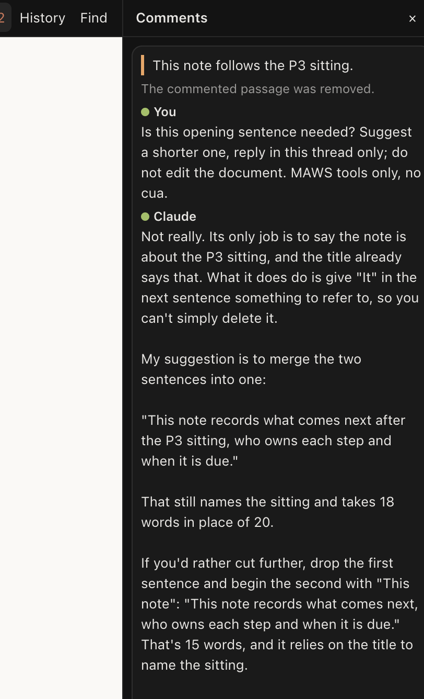
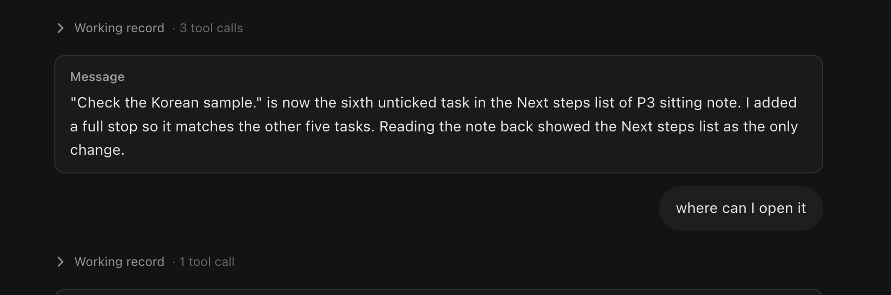
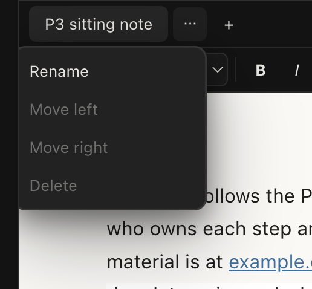
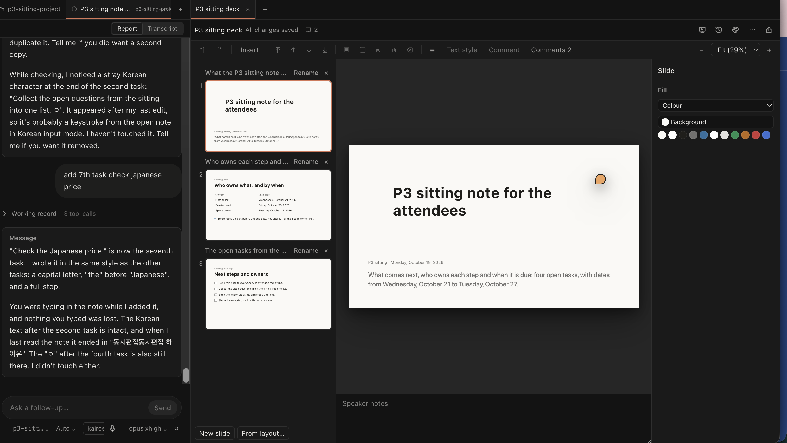
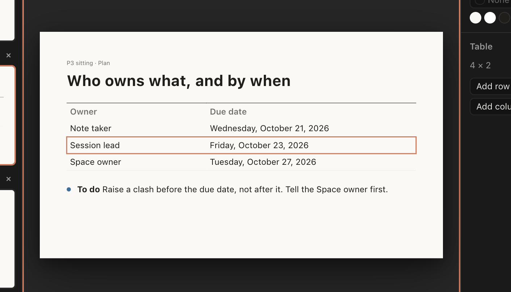
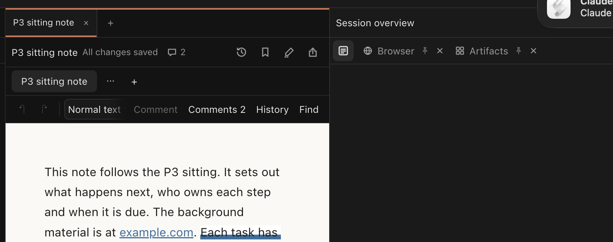
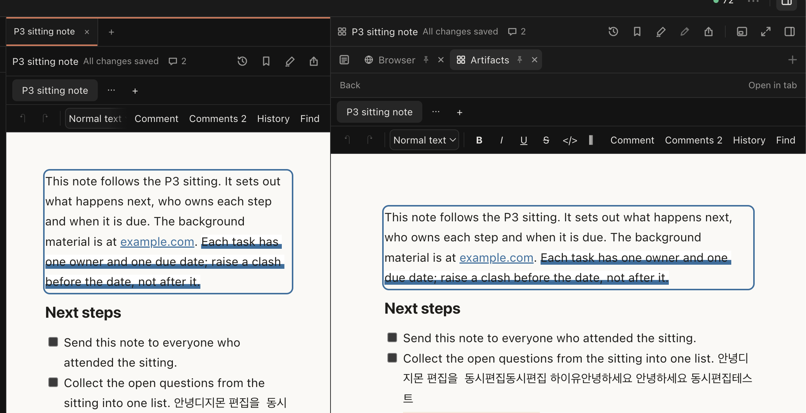
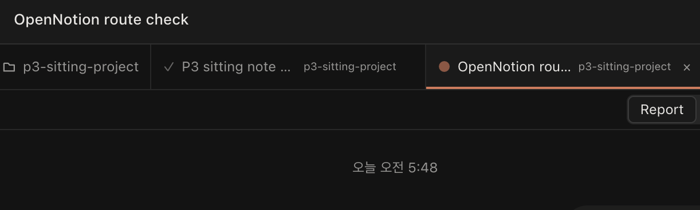
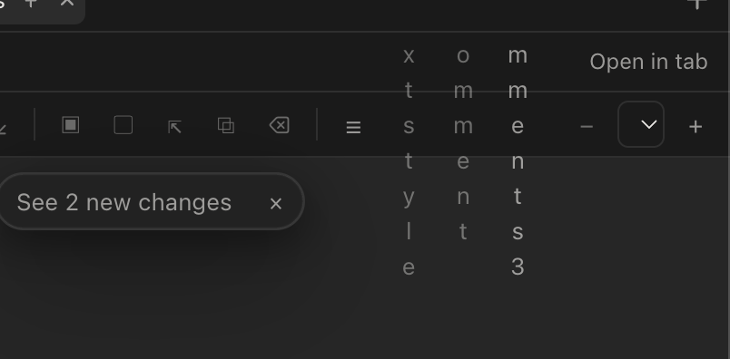

# The owner's additional observations after the sitting (2026-10-19): grounding, rulings and plan

Parent: `docs/doperpowers/plans/2026-10-12-p3-co-work.md` (P3; this file is cited by its Decision Log 111 and by §9 as the next cut's input). Source: the owner's vault note `WorkStation Design/Additional observations.md` (titled 무제.md when written, 13:33Z), copied verbatim with its nine screenshots under `sitting-visual/owner-notes/` (`additional-observations.vault.md`, `obs-1.png` to `obs-9.png`). Grounding: a read-only pass over master ee20e1230 by the architect's grounding agent (fable), every claim cited as path:line; the architect's rulings follow each section. Candidate N refers to `sitting-findings.md`; tracker rows are cited by line in `docs/tech-debt-tracker.md` at ee20e1230.

Three corrections to the owner's framing, found in the code: (a) MAWS installs no SessionStart hook; the only prose it adds to a session is the `--append-system-prompt` to-human contract, which is skipped when the owner's own output style already carries it (`src/engine-host/session-start-hooks.ts:1-7` only reads the user's hook timeouts; `src/shared/owner/contract.ts:86`; candidate 31). (b) The floating session card is a right-panel state: nothing keys it on the editor's kind, and the deck-versus-document difference the owner saw is placement (the document was in the panel, the deck in a main tab), not kind. (c) The project item in the tab strip is W12's `ProjectLabel` from the owner's own 2026-10-01 rulings (`docs/charter.md:183`), not P3-G's pill.

## The owner's note (verbatim)

코멘트는 좀 구글 독스처럼 자연스럽게 원본 문서 옆에 코멘트 블록으로 뜨게 하자, 이렇게. 코멘트 열었다 닫았다 하는 UX는 좋지 않다

코멘트를 가리게 하는 건 되는데 기본을 그냥.녹스처럼 그냥 구독자 똑같이 거의 똑같이 그냥 오른쪽에 나오게 하면 훨씬 더 시각적으로 자연스러운 형태가 되는 거지. 이러면 이제 코멘트 바랑 원문이랑 약간 분리가 된 느낌이지. Whereas 구글 독스처럼 그 하이라이트한, 코멘트 하이라이트한 부분 바로 옆에 코멘트 블락이 오른쪽 사이드에 붙고 그런 식으로.

  

더할것: inline 하이퍼링킹. Agent can already open the document for human, but instead we can also let agent just Hyperlinked artifact which opens on the sidebar when human clicks.
(and this adds to SessionStartHook for MAWS as instruction to hyperlink artifact or whatever so that human can open on sidebar with click)

So that the human doesn't have to ask again, can you open it for me? Where can I open it? And so on and so on. Just inline message hyperlinking opens the file within MAWS.

(Like output style rendering with markdown backlink reference opens that file on cmd+click, some sort of reference linking in-line message should let user open that artifact/file by click)

  

—> Three dot is not needed, Just make it like a regular web browser. Right click replace three dot, and ‘x’ is embedded in block so that closing artifact tab is easy

--> deck 편집중: docs처럼 사이드바를 특정 수준 이상 확장했을때 채팅이 오른쪽 아래 floating widget으로 축소되는게 없다. 이것도 필요

--> 슬라이드 편집이 상당히 스무스하지 않다. 캔바나 구글 슬라이드처럼 컴포넌트를 눌렀을 때 바로 편집 가능한 게 아니라 두 번, 세 번, 더블 클릭, 트리플 클릭해야지 텍스트를 수정할 수 있는 상태가 나온다. 이 부분에 대해서도 생각해봐야지 않을까.

Design도 마찬가지. 접근성 트리? DOM? 이 너무 구리다. 구글 슬라이드/캔바의 검증된 메커니즘을 그대로 Adopt하기.

추가질문: Artifact Search 툴 있나? slide, docs, design, dashboard 등등을 그때그때 검색으로 로딩하게 해주는 툴 같은것? 그게 없다면은 모델은 어디에서 아티팩트의 맥락을 가져오는 건지, 세션에 로드된 아티팩트만을 기준으로 하는 건지?

오른쪽의 sitting note또한 artifact인데 오른쪽의 사이드바 탭을 join할 . 수없는 모습이다. 탭에 대한 drag to move가 막힘.

--> 그래서 이렇게 중복으로 열린 모습

MInor UX:

맨 오른쪽의 'p3-sitting-project' (프로젝트 이름 표시 탭) --> 이건 탭 자리 말고 탭 위의 공간 (opennotion route check 글씨가 있는 바 공간) 에 들어가야한다. 탭은 안그래도 crowded하고 공간이 부족한데 별거 안하는 프로젝트 표시탭을 저기다 두면 안된다.
프로젝트 표시 아이콘/탭을 탭바 위 공간의 바로 올리고, 클릭 할시에는 해당 프로젝트의 새 탭 공간을 열게 하자
(왼쪽 사이드바에서 프로젝트 옆 '+'누르는것과 같은 효과)

I don't know whose bug this is, but there are alphabets just floating there.

## 1. Comments beside the passage, as in Google Docs

**Mechanism.** The document's threads are a rail: `ThreadsRail` (`src/artifacts/document/editor/comments/ThreadsRail.tsx:33-73`), toggled by the toolbar's "Comments N" (`Toolbar.tsx:360-361`, `DocumentEditor.tsx:164-167`), state `rail: 'comments' | 'history' | null` (`DocumentEditor.tsx:107`, held by the X32 header through `props.rail`), rendered beside the page (`DocumentEditor.tsx:258-271`); `rail-layout.ts:11,34` gives `beside` from 720 px and a drawer below; CSS `chrome.css:361-388`. Anchor marks are the `comment comment-<threadId>` decorations (`comments/plugins.ts:119,144`); the page is centred with gutters on both sides (`theme.css:21-26`, `chrome.css:46-50`). The positioning machinery a margin needs already exists: `passageRect` (`DocumentEditor.tsx:596-604`) exposed as `CommentOverlayProps.locate` with a `layoutKey` that changes on edit, scroll and resize (`comments/surface.ts:28-45`); today only the composing card uses it (`src/renderer/src/side/card/CardHost.tsx:63-127`, `placement.ts:14-21`). The deck and the design share one `CommentsRail` and pins at each commented element (`slides/editor/comments/CommentsRail.tsx:27-73`, `Pins.tsx:49-72`; `design/editor/comments.tsx:1-12`). Governing clause: P3-B D9 (`2026-10-12-p3-b-documents.md:103`, "the threads list is the editor's right rail tab beside History").

**Verdict.** A deliberate P3-B design the owner now wants replaced for documents; not a defect. For the deck and the design the proven pattern (Canva, Figma, Slides) is pin to anchored popover, not a margin.

**Plan.** Document: a `margin` rail mode, `comments/MarginThreads.tsx` rendered inside `.doc-page-frame` as an absolutely positioned 300 px column right of the page; for each open thread of the shown tab `top = passageRect(threadId).y`, sorted, collision-stacked with a gap, the active thread pinned to its own anchor and the neighbours pushed (Docs' rule), re-laid on `layoutKey`; cards reuse `ThreadItem` (`ThreadsRail.tsx:86-136`); the existing list stays as "All comments" (other tabs, resolved) behind the toolbar button; "Hide comments" collapses the margin to pins; `rail-layout.ts` takes `'margin'` when the frame leaves `CARD_WIDTH + 2·gap` beside the page, else today's `beside` and `drawer`; `.ds-doc` gets `padding-right: var(--doc-margin-w)` so the page stays centred; the composing card's `placeCard` gains a margin mode. Deck and design: a pin click opens a `ThreadPopover` at the pin instead of the rail (`Pins.tsx:67`). Tests: a DOM test asserting card tops equal passage line tops in order, stacking on overlap, the active card at its anchor, the width fallback; the document e2e cases that read `.doc-rail` updated; a deck DOM test for the popover. No surface or IPC change.

**Size and risk.** Document 2 worker-days, deck and design 1; medium (the overlay coordinate space shared with the card host, the F1 drawer, the X32 held rail state, the document e2e).

**Ruling and route.** Next cut (the extension phase), first design item for documents; the pin popover follows. Not wave S: a medium-risk design change does not belong in the finish. Related: tracker rows 2026-10-09 P2-E1 (the card does not follow the scroll; the margin built on `locate` resolves it) and its docked-layout sibling; candidates 25, 48, 49, 24.

## 2. Inline artifact links in agent messages

**Mechanism.** Transcript markdown goes through one Streamdown wrapper (`src/renderer/src/transcript/view/markdown/Markdown.tsx:23-34`, `options.ts:14-16`); `sanitize.ts:37,49,53,69` keeps an href only for `https`, `http`, `mailto`, `maws-path`, `maws-image`; `Link.tsx:26-54` renders `maws-path:` as a chip calling `actions.openFile` and everything else as an external link. No artifact scheme exists: `maws-artifact://<id>/<rev>/<path>` (`src/shared/artifacts/scheme.ts:2`) is main's content protocol for frames and is stripped by the gate; the document's `@` mention chip has no click handler (`document/editor/nodes/views.ts:209`). The open rule is panel by default, main tab on demand (`2026-10-12-p3-co-work.md:52`): `openArtifactInPanel` (`tools/artifacts/ArtifactsTool.tsx:51-54`, the transcript action `openArtifact`, `App.tsx:267`) and `openArtifactTab` (`library/actions.ts:48-54`). The only tool that opens for the human is `show_pane {pane:'artifact', target}` (`src/shared/maws/tools.ts:442-448`; `engine-host/tool-server/show-pane.ts:12-26`), by store UUID or a handle over the session lineage (`engine-host/documents/store.ts:310-320`). There is no SessionStart hook; MAWS's prose is `--append-system-prompt` (`engine-host/launch.ts:236`) carrying the to-human contract or its supplement (`src/shared/owner/contract.ts:67-99`), and nothing is appended when the owner's output style carries the full contract (`contract.ts:86`), the owner's case.

**Verdict.** A new capability, small; not a defect. It removes the recurring "where can I open it" turn.

**Plan.** Scheme `maws-artifact:<uuid>` (optionally `#v<version>`; a `//` content form reduced to its id). Gates: add the scheme at `sanitize.ts:49,53,69` (the chip only calls an action, so the posture that nothing loads by path holds). Renderer: a `maws-artifact:` branch in `Link.tsx` rendering a `transcript-chip` that calls `actions.openArtifact(rowSession, id)` (panel) and on ⌘-click `openArtifactTab(id)` (main tab); the same branch in `engine-surface/SurfaceTree.tsx:300` for plugin surfaces; optional kind icon and title from the library store. Instruction to the agent, in two places because the contract is conditional: the `artifact_create` and `artifact_list` tool descriptions (`tools.ts:450-463`) and the create result's kind guide (`artifact-tools.ts:159`), plus a short paragraph always appended when the `maws` server is offered (`src/main/sessions/launch-mapping.ts:84-106`; `launch.ts:241` already keys on it): "Artifacts you create or edit have ids. When a message names one, write it as a Markdown link `[its title](maws-artifact:<artifactId>)`; the human opens it in MAWS with a click. Call `show_pane` only when the human should see it now." The append is a no-op under a prompt snapshot until the next compaction (`main/owner/launch.ts:8-10`), so the descriptions matter for resumed sessions. Tests: `sanitize` and `Link` units (scheme kept, click and ⌘-click actions), an `e2e/maws-tools.spec.ts` case where an assistant message's link opens the Artifacts record, a protocol-probe fixture showing the appended prompt in `session.init` (D-1: verify on the wire).

**Size and risk.** 1 worker-day, low; no engine or IPC change.

**Ruling and route.** Wave S, second tier: after the defects, if the wave's schedule holds to tonight's hand-back; otherwise the first item of the next cut. Related: tracker row 2026-10-14 P3-B (`show_pane` cannot open a document at a tab or block; the link's fragment can carry it later); candidates 75, 11, 5, 32.

## 3. The document's own tab row: right-click menu and an inline close

**Mechanism.** The row under the artifact header is the document's tab strip, `src/artifacts/document/editor/Tabs.tsx:54-117`: `button.doc-tab` with native drag reorder and double-click rename, one "Tab options" ⋯ button (`:88-110`) with Rename, Move left, Move right and Delete acting on the active tab, and "+" (`:113-115`); CSS `chrome.css:58-96,247`; P3-B D1/M3 (`2026-10-12-p3-b-documents.md:59`). The main-area tab already has the browser pattern: an embedded × on hover or when active (`src/renderer/src/main/Tab.tsx:152-167`) and a Radix context menu (`:171-185`). Radix is already used inside the portable `src/artifacts` tree (`slides/editor/menus/TextStyle.tsx:6`), so `Tabs.tsx` can take `ContextMenu` without a renderer import.

**Verdict.** A deliberate P3-B design; the owner wants the browser pattern. A small design change.

**Plan.** Wrap each tab in `ContextMenu` with Rename, Move left, Move right and Delete acting on the right-clicked tab; drop the ⋯ button and its state; an inline × per tab (`aria-label` "Delete <title>", shown on hover or when selected as in `Tab.tsx:163-165`). The × means Delete, a destructive act unlike closing a browser tab: keep the `tabs.length < 2` guard (`:37`), confirm when the tab has content, and rely on History's Restore (`p3-b-documents.md:38`) for recovery. CSS: `.doc-tab` inline-flex with `.doc-tab-close`; remove `.doc-tab-menu-anchor`. Tests: `DocumentEditor.dom.test.tsx:245-246,268,567-569` and `e2e/document.spec.ts:609` switch from "Tab options" to `contextMenu`; new cases: × deletes a tab (guarded), no × on the last tab, right-click acts on the clicked tab, not the active one. Do it with tracker row 2026-10-19 (a tab drop names no source document, `Tabs.tsx:46-51`), same file.

**Size and risk.** 0.5 worker-day, low.

**Ruling and route.** Wave S, first tier.

## 4. A deck in a main tab does not shrink the chat into the floating card

**Mechanism.** Floating is a right-panel region state (`src/shared/ipc/schema/layout.ts:88`; `stores/layout.ts:143-149`), triggered only by the panel divider dragged past the panel's maximum (`panel/PanelRegion.tsx:54-55`, `app/Resizer.tsx:109-113`), ⌥⌘B or the header's Float button (`app/shell-actions.ts:33`, `panel/PanelHeader.tsx:173`), and Dock. The card draws the focused main tab's session (`shell/floating.ts:91`, `stores/layout-model.ts:101-112`), which is null for an artifact tab, so `FloatingCard.tsx:104` draws nothing while `panelInMain` (`app/regions.ts:44,51`) still puts main at 0 px and inert. The split divider between two main panes has no expand threshold and clamps at 25-75 % (`main/SplitDivider.tsx:16-25`). Spec: `2026-10-12-p3-g-shell.md:74,133,139,266`; the seed `2026-10-10-floating-session-card.txt`. No code keys floating on the editor's kind. What the owner compared: the document floated because it sat in the panel (candidate 12); the deck sat in a main pane beside the session (obs-4), where no divider can float; pressing Float with the artifact tab focused blanks main with no card, which is candidate 58, the owner's "defect" on the G line.

**Verdict.** Candidate 58 is a defect by consequence (P3-G's `:133` never considered the artifact main-tab kind that P3-L added later). "Widen a main-tab editor past a threshold and the chat becomes a card" is a new design, since the card model is panel-based.

**Plan.** Wave S, candidate 58: a float with no card session must not blank main; keep the panel docked while floating with `cardSession === null` (`regions.ts:44`), or refuse the float in `togglePanelFloat` and `floatPanel` (`floating.ts:142-173`) with a notice; tests in `floating.test.ts`, the `FloatingCard.test.tsx:184` family and `regions.test.ts`. Next cut, a P3-G Decision Log entry with an X5 note: the split divider gains `expandThreshold` and `onExpand` so dragging the session pane below its minimum collapses it into the card drawn over the main area; `cardSession` takes the collapsed pane's session; the card layer, the pill host, `revealMain` and the persisted split state change.

**Size and risk.** The 58 fix 0.25-0.5 worker-day, low; the main-area float 2-3, medium-high.

**Ruling and route.** Wave S takes the 58 fix (already in the wave's list); the main-area float is the next cut's. The owner's intent is served today by placing the editor in the panel and floating. Related: candidates 58, 12, 59, 45, 41.

## 5. Slide and design text editing takes two or three double-clicks

**Mechanism.** Selection is pure over the model (`src/artifacts/slides/editor/transform/selection.ts`): `pick()` (`:53-72`) picks at the current scope's level, the slide's own children first, so a group or a table is picked whole; `drill()` (`:75-87`) on a double-click goes one level into the selected container and returns `'edit'` only when the selected element itself is a non-container text tag (`:80`; `TEXT_TAGS` and `CONTAINER_TAGS`, `slides/ir.ts:79-81`). `Overlay.tsx`: pointerdown picks (`:166-167`), double-click drills (`:226-243`), Enter on a selected text element edits (`:300-304`), printable keys are not handled (`:286-331`), so typing on a selected text box is dropped (candidate 43). `TextBox.tsx` mounts Tiptap with all text selected (`:93-146`), Escape ends (`:121`). The design mounts the same overlay on the active board; a press on an inactive board only activates it (`design/editor/World.tsx:240-242,461-474,602-612`). Spec: `2026-10-12-p3-c-presentations.md:128,131`. The stage is one `role="region"` with plain `data-eid` nodes and an SVG selection polygon (`Stage.tsx:61`, `Overlay.tsx:406`): no element-level node in the accessibility tree, as the owner remarked. A grouped heading takes click, double-click, double-click; the obs-5 table cell takes click, then three double-clicks.

**Verdict.** A deliberate P3-C design (level-by-level picking) now judged wrong against Slides and Canva; the dropped typing is a defect under any model (candidate 43).

**Plan.** The Slides/Canva state machine: idle → selected(ids) → editing(id). A single click keeps level picking (groups and tables stay movable as units) except that `tr` becomes transparent to `pick`; a double-click anywhere resolves the deepest text element under the pointer from `hits` (`measure.ts:186-203`) regardless of nesting and enters edit with the caret at the pointer (`posAtCoords`; select-all only for a placeholder); a second single click (press and release without a drag, `onUp` `:196-203`) on the one selected text element enters edit at the point while a drag still moves; a printable key or Backspace on a single selected text element calls `editText(id, {typed})` and `TextBox` inserts the pending text after bind; Escape returns editing to selected, then up; on a design board a double-click on an inactive board activates and drills in one gesture. Files: `selection.ts`, `Overlay.tsx`, `TextBox.tsx`, `session.ts:254-257`, `World.tsx`. Tests: `selection.dom.test.tsx:54` extended (a grouped heading or a table cell edits on one double-click), `transform.dom.test.tsx` (click on selected text edits, drag still moves, typing enters edit with the text, Escape), `TextBox.dom.test.tsx:66` (caret at point), `e2e/presentations.spec.ts:569` plus a grouped-heading case and the same on a design board. Element-level accessibility roles are a separate row.

**Size and risk.** 2 worker-days, medium (gesture and drag thresholds, the IME composition hold, the design's activation press, mini e2e flakiness).

**Ruling and route.** Wave S takes the dropped-typing defect only if P3-F bounds it to about half a day (a printable key on a single selected text element enters edit carrying the key); the state machine is the next cut's first editor item, as a tracker row of high priority quoting the owner. Related: candidates 43, 33, 38, 35, 42.

## 6. Is there an artifact search tool; where does the model get artifact context

**Mechanism.** The `maws` MCP server is MAWS's own JSON-RPC over the control protocol (`engine-host/tool-server/server.ts:56-59,113-121`; names in `src/shared/maws/tools.ts:29-37`, `dashboard-tools.ts:8`, `document-tools.ts:11`; the model sees `mcp__maws__<name>`). The tools a session sees: `send_file`, `ask`, `show_pane`; `artifact_create` (any kind, no Space field), `artifact_list`, `artifact_screenshot`, `artifact_describe_type`, `artifact_read` (live or a version, ranges), `artifact_publish`, `artifact_upload_asset`, `artifact_list_assets`, `artifact_export`; the document family wrapped for decks, designs and dashboards: `artifact_edit`, `artifact_comments`, `artifact_reply`, `artifact_resolve`; the dashboard's `artifact_dataset`. There is no search tool: `artifact_list {kind?, spaceId?, scope: 'session' | 'all', query?}` matches `query` as a title substring only (`engine-host/documents/store.ts:300`, the comment at `:58` "a title substring until P3-L's index"), defaults to the session lineage (`artifact-tools.ts:70`), returns no `spaceId` and no paging. So the model's artifact context is: what its lineage created, edited or viewed; anything it can name by id or handle; ids it is handed (the create result; an anchored comment's lead); and, for a Space linked to a directory, the read-only mirror under `<linkedDir>/artifacts/` that a grep finds (`engine-host/library/mirror.ts:1-3`), which no agent-facing text mentions. An index exists but belongs to main: FTS5 `library_text` over titles and bodies (`src/main/index/migrations.ts:233`; `library.list {filter:{query}}`), used only by the library UI and the mention picker.

**Verdict.** A gap, not a defect: the substring query was explicitly provisional until P3-L's index, which landed in main and was never surfaced to the agent.

**Plan.** `artifact_search {query, kind?, spaceId?, scope?, limit?}` returning `{status:'found', hits:[{id, handle?, kind, title, spaceId?, spaceName?, updatedAt, snippet, score}]}`; the engine host owns every artifact write, so it mirrors the FTS5 table into its own SQLite (`documents/store.ts`) and updates it in the write path (it already produces the text main indexes), making the tool a local query with no new host-to-main IPC. Add `spaceId` and `spaceName` to `artifact_list` results and accept a Space on `artifact_create` (the root of candidates 5 and 32, which the owner's DL13 change already orders). Tests: host-store unit (title and body hits, trigram, kind and Space filters, snippet), a tool test beside `ipc-e8.test.ts`, a protocol-probe fixture of the new `tools/list` entry.

**Size and risk.** 1-2 worker-days, low to medium.

**Ruling and route.** The Space on `artifact_create` and in `artifact_list` results is part of wave S's DL13 item (bounded as that item is bounded); `artifact_search` itself is the next cut's, second after the editors. Related: candidates 5, 32, 1, 55, 41; tracker row 2026-10-14 P3-L (the All list is not virtualised).

## 7. Tab drag between the main strip and the panel is blocked

**Mechanism.** The main strip uses native HTML5 drag with the type `application/x-maws-tab` (`main/Tab.tsx:34,128-134`; `main/TabStrip.tsx:36-44`; `DropEdge.tsx`); the charter chose native DnD (`docs/charter.md:404`). The panel's tool strip (`src/renderer/src/panel/TabStrip.tsx`) has no drag code; the Artifacts tool is single-instance and shows a list or one record (`ArtifactsTool.tsx:56,215-216`). The open rule allows both places (`2026-10-12-p3-co-work.md:52`; `2026-10-12-p3-l-library.md:58`, DL 8: "several may be open, each with its own replica"), and nothing deduplicates across surfaces: `openArtifactTab` activates an existing main tab (`library/actions.ts:48-54`) but never consults the panel, and the reverse. The record view's "Open in tab" copies rather than moves (`tools/artifacts/RecordView.tsx:23`), which contradicts the ballot's caption ("moves the artifact shown here into a main tab", `sitting-visual/ballot/index.html:284`). A panel tab ref carries no artifact id (`layout.ts:72`), which is also why a restored pinned tool loses its record (candidate 71). The browser already has one-place-at-a-time semantics ("Open in tab" / "Show in panel", `tools/browser/chrome/OverflowMenu.tsx:87-95`).

**Verdict.** A design (DL 8 allows both replicas); the owner wants a move. An enhancement in two tiers.

**Plan.** Wave S: "Open in tab" becomes a move (after `openArtifactTab`, Back the record through the close guard `askEditorHostClose`, `ArtifactsTool.tsx:123`); "Show in panel" joins the artifact main tab's context menu (`Tab.tsx:171-185`, for `tab.kind === 'artifact'`: `openArtifactInPanel(focused pane's session, id)` then close the tab); the ballot caption corrected. Tests: `tools/artifacts/artifacts.test.tsx:433-438` extended to "the record goes Back"; a `Shell.test.tsx` menu case. Next cut: cross-surface drag; the panel strip and body accept `application/x-maws-tab` when the dragged tab is an artifact (`stores/layout.ts:42` `dragging.tabId`) and open it in the panel while closing the main tab; panel tabs become draggable with `application/x-maws-panel-tab` carrying `{toolId, tabId}`, and the main strip accepts it when the instance shows a record; `dragging` gains `source: 'main' | 'panel'`.

**Size and risk.** The move 0.5 worker-day, low; the drag 1-2, medium.

**Ruling and route.** Wave S takes the move and the menu item; the drag is the next cut's. Related: candidates 41, 71, 58.

## 8. The project label out of the tab strip, into the bar above

**Mechanism.** The strip's leftmost item (obs-8 shows it leftmost; the note says rightmost) is `ProjectLabel` (`src/renderer/src/main/TabStrip.tsx:125,164-181`): a folder icon and the name, click → `revealProject` (`sidebar/reveal.ts:30-54`: restores a hidden project, opens the sidebar, focuses its row, opens no tab). Governing clause: `docs/charter.md:183` (W12, the owner's second look of 2026-10-01: "the strip shows the current project's set (its name as a small label at the strip's left)" and "there is no second chrome row above the tab strip"). The bar above the strip is `app/Toolbar.tsx` (the window's title bar, drag region `:86`, the focused tab's title `:112`). The sidebar's "+" is `sidebar/ProjectRow.tsx:147-157` → `createSession(projectId)` (`keymap/actions-runtime.ts:52-69`: a new unstarted session tab, which switches the strip to that project's set); the strip's own "+" does the same for the focused project (`TabStrip.tsx:194`). P3-G's "pill/tab-row", which the owner marked keep, is the floating card's closed pill in the browser chrome's tab row, a different thing.

**Verdict.** A deliberate W12 design from the owner's own rulings, now reversed by the owner. A small change; the title bar exists already, so no new chrome row is added, which keeps the 2026-10-01 correction's point.

**Plan.** Remove `<ProjectLabel />` from the strip; add a project chip in `Toolbar.tsx` left of the title inside a `no-drag` region, reading the current project from the layout and sessions stores; click → `createSession(project.id)`, the "+" effect: a new unstarted session tab in that project's set, not an empty workspace; the reveal-in-sidebar affordance stays as the chip's secondary action (right-click or a hover button), since `revealProject` is the only way a hidden project's set gets its row back. Tests: `MainArea.test.tsx:684-697` moves to a Toolbar test; `e2e/shell.spec.ts:70-91` updates its selector; a Sidebar test through the secondary action. The charter's `:183` line gains a dated §19 amendment, written by the architect at the landing.

**Size and risk.** 0.5 worker-day, low.

**Ruling and route.** Wave S, second tier with item 2, under the same schedule condition; the charter amendment is the architect's at P3's recomposition. Related: candidates 59, 57.

## 9. Letters floating in a column: the deck toolbar in the narrow panel

**Mechanism.** `.deck-toolbar` (`DeckEditor.tsx:357`; `slides/editor/chrome.css:50-59`: `display: flex; height: 36px`, no wrap or overflow rule) with `.deck-button` children (`chrome.css:63-77`: `min-width: 26px`, no `white-space`, default `flex-shrink: 1`): in a narrow panel each button shrinks to 26 px and its label wraps one letter per line over the canvas (obs-9: "Text style", "Comment", "Comments 3"). `.deck-text-style`'s `min-width: 84px` (`menus/menus.css:17-20`) loses to sheet order. The design workbench fixed its own instance of the same toolbar in its own scope (`design/editor/workbench.css:6-36`: `flex-wrap: wrap; height: auto`, children `flex-shrink: 0`, buttons `white-space: nowrap`). The document toolbar is different code (`.doc-format-toolbar`), fixed by P3-F1's scrolling strip (`document/editor/toolbar-strip.ts`, `chrome.css:157-200`). Toolbars that can still wrap this way: the deck toolbar including its element bar, comment buttons, text-style menu and zoom select, and the deck history bar; safe already: the deck notice, the text-box mark bar, the filmstrip titles, the design toolbar, the dashboard sheet rows, the document toolbar, the panel header. The same family outside toolbars: candidates 2 (the Session overview heading) and 29 (the "Editors of the selection" popover).

**Verdict.** A defect; candidates 37 and 40 log it.

**Plan.** Promote the design's rules to `.deck-toolbar` itself (`flex-wrap: wrap; height: auto; min-height: 36px; > * { flex-shrink: 0 }`; `.deck-button, .deck-zoom { white-space: nowrap }`; `.deck-element-bar { flex-shrink: 1; min-width: 0; flex-wrap: wrap }`) and delete the design-scoped copies; wrapping rows beat F1's scrolling strip here because the deck's Radix menus portal and need no repositioning. Proof is e2e (happy-dom does no layout): a deck-in-panel case at the 280 px minimum asserting every toolbar button has `clientHeight ≤ 36` and `scrollWidth ≤ clientWidth`, modelled on `e2e/document-narrow.spec.ts`; sweep candidates 2 and 29 in the same pass.

**Size and risk.** 0.25 worker-day, low.

**Ruling and route.** Wave S, first tier, as E1's class (sent to P3-F at 14:4xZ).

## Routing summary

| # | Observation | Verdict | Route | Size |
|---|---|---|---|---|
| 1 | Margin comments beside the passage | design change (P3-B D9) | next cut, first document design item; deck and design pin popover after | 2 + 1 days, medium |
| 2 | Inline artifact links in agent messages | new capability | wave S second tier, else first of the next cut | 1 day, low |
| 3 | Document tab row: context menu and inline × | design change (P3-B M3) | wave S first tier, with the 2026-10-19 tab-drop tracker row | 0.5 day, low |
| 4 | Deck in a main tab does not float the chat | candidate 58 defect; main-area float is new design | wave S fixes 58; the main-area float is the next cut's | 0.25-0.5 + 2-3 days |
| 5 | Slide and design click-to-edit | design change (P3-C); dropped typing a defect | wave S takes the dropped typing if bounded; the state machine is the next cut's first editor item | 2 days, medium |
| 6 | Artifact search tool | gap | Space on create and list rides wave S's DL13 item; `artifact_search` is the next cut's | 1-2 days |
| 7 | Tab drag main to panel | design (DL 8) | wave S: "Open in tab" moves, "Show in panel" menu item; the drag is the next cut's | 0.5 + 1-2 days |
| 8 | Project label into the title bar | design change (W12), owner reverses | wave S second tier; charter §19 amendment at the landing | 0.5 day, low |
| 9 | Deck toolbar letters wrapping | defect | wave S first tier (E1's class) | 0.25 day, low |

Wave S's schedule rule for the second tier (items 2 and 8): they ride only if the wave still hands back tonight (2026-10-19 UTC) with its named-group gate; otherwise they open the next cut, whose seed this file is together with `sitting-findings.md` and the owner's forthcoming marks on the 80 candidates.
