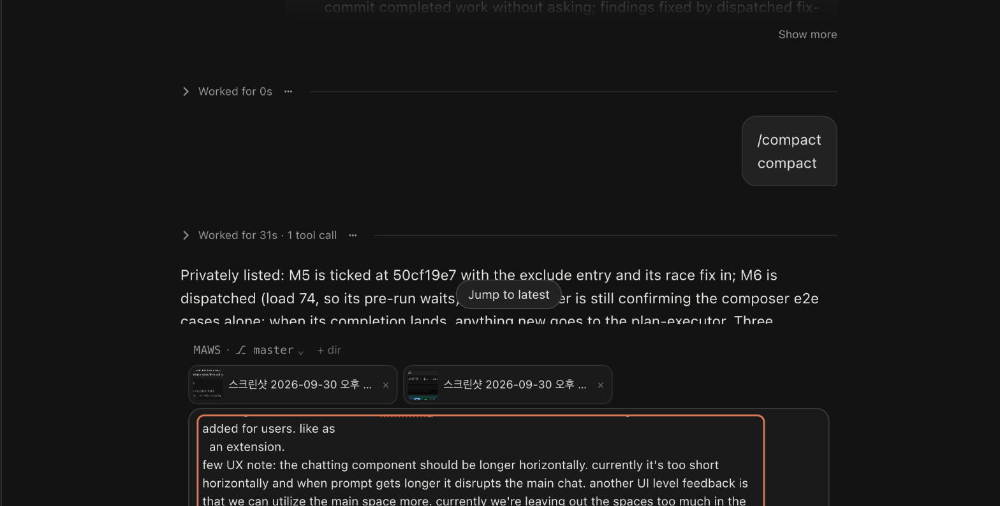
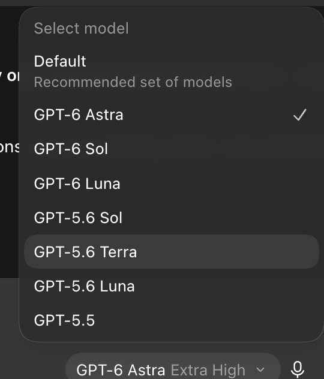
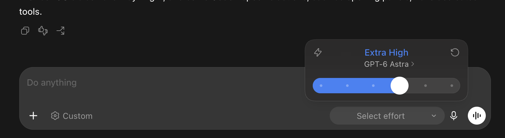
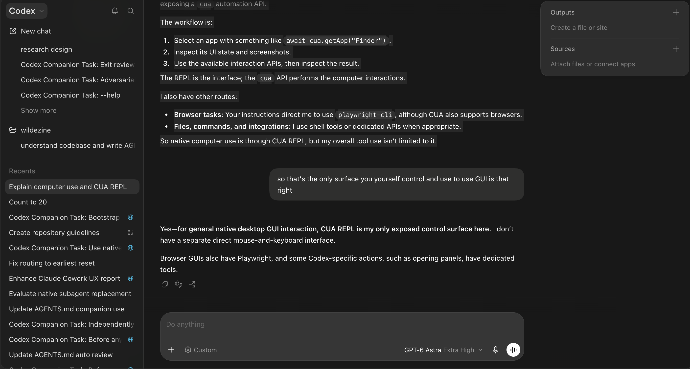
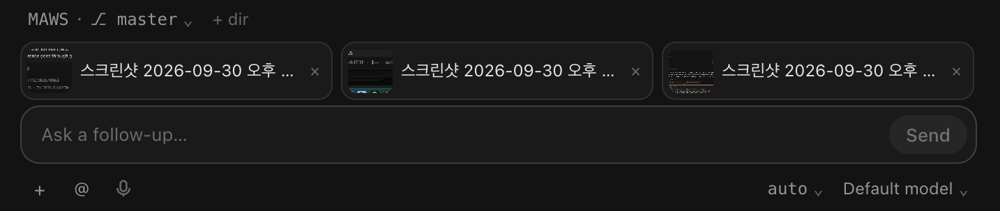
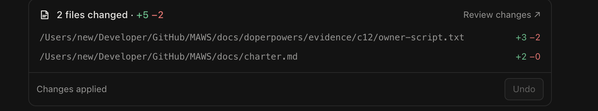

# UX fundamentals: enhancement waves

Child document of `docs/charter.md` (§19 entry "UX fundamentals study, 2026-10-01"). Status: **study, no fixes dispatched**. Filed by the architect from the owner's notes of 2026-09-30, grounded against the code at master `a2dca3a0` and against the three reference implementations. The owner's answers to the first question round are recorded in §6 as they arrive; items whose decision is still open say so.

Purpose. The working base is good but not production level. Before sidebar and extension work, the fundamentals must match the bar set by Codex desktop and Claude Desktop (charter D-14, D-20). This document turns the owner's observations into items a worker can fix without re-investigating: for each item, the owner's words, what the code does today with file and line, what the references do, the direction, and what only the owner can decide.

How to read the evidence. Every "today" claim is cited to a file and line at `a2dca3a0`. The full study reports, with more citations and the measurements behind the numbers, are checked in under `docs/doperpowers/evidence/ux-2026-10-01/` (`a1-composer.txt`, `a2-transcript.txt`, `a3-sidebar.txt`, `a4-engine.txt`, `r1-codex.txt`, `r2-claude-desktop.txt`, `r3-t3code.txt`, `r4-usage.txt`, `owner-observations.txt`). The owner's screenshots are under `docs/doperpowers/plans/shots/2026-10-01-ux-notes/` and are referenced as "shot NN".

Reference sources (read-only; D-1 forbids patching the engine, and none of these is the engine):

| Reference | Where | Use |
|---|---|---|
| Codex desktop 26.924, readable source | `/Users/new/codex-app-src/readable/chatgpt-26.924/` (maps: `research/codex-thread-ux.md`, `research/codex-shell-ux.md`) | interaction, density, composer, model picker, receipts |
| Claude Desktop 2.9939.2 + web bundle | `/Users/new/claude-desktop-re/` (map: `research/claude-desktop-ux-and-engine.md`) | engine wiring, AskUserQuestion, side chat, permission modes |
| T3 Code (open source), shallow clone | `/Users/new/t3code-src` (HEAD 148e6dee) | basic functional patterns; not a reference for live-session custody |
| ClaudeUsage (owner's menu-bar app) | `/Users/new/Developer/GitHub/claude-usage-menubar` | the usage control pattern to copy |
| Pinned engine 2.1.283, spec and fixtures | `~/claude-code-bundle/2.1.283/SPEC`, `spikes/protocol-probe/fixtures/` | wire truth |

## 0. The owner's screenshots

Referenced as "shot NN" throughout. Relative paths are under `docs/doperpowers/plans/shots/2026-10-01-ux-notes/`.

| Shot | Image | What it shows |
|---|---|---|
| 01 |  | MAWS composer toolbar (`+ @ mic`) and the two-line status line under it (C2, C3) |
| 02 |  | MAWS status line: cwd, `ctx — · 5h 0% · 7d 36% ↻4d23h · $— · auto` (C3, E1) |
| 03 |  | MAWS session pane: centred 702px column with wide margins, large user bubble, "/compact compact" two-line bubble, "Worked for 0s", Jump-to-latest pill over prose (B1, B2, B3, A3, A5) |
| 04 |  | MAWS answered AskUserQuestion history row: every question and option rendered, "Ran 2 hooks" rows (B4, A4) |
| 05 |  | Codex model list view: "Select model", "Default · Recommended set of models", check mark (C4) |
| 06 |  | Codex effort view: effort name in accent, model name with chevron, slider, lightning and reset, chip reads "Select effort" while open (C4) |
| 07 |  | Codex window: 291px sidebar, 768px thread column, docked summary card, composer as wide as the thread, nothing under it (B1, C1, D1) |
| 08 |  | MAWS composer today: chip row above the box, attachments, toolbar with `auto ⌄` and `Default model ⌄` (C2, C4, C5) |
| 09 |  | MAWS files-changed receipt: absolute paths, "Review changes ↗", "Changes applied", Undo (B5) |
| 10 |  | MAWS sidebar rows at 49px with the literal `<to-human>` summary line (D2, D5) |
| 11 |  | MAWS final answer rendered muted between "Thought for 1s" and "Ran 2 hooks", with the hook's "to human" label (A1, A4) |
| 12 |  | MAWS Edit: the text moves into the composer under "Editing an earlier message · sending forks this session from here" (B6) |
| 13 |  | Codex Edit: the bubble itself becomes an editor with Cancel and Send (B6) |

## 1. Shared understanding

These are the standards every wave is measured against. They come from the charter and from the owner's notes and rulings of 2026-09-30 and 2026-10-01.

1. **Reference first (D-20).** Where the owner's notes do not say otherwise, a surface is built the way Codex desktop or Claude Desktop builds it, with their measured values, not approximations. "검증된 UI 비율이다" (these are verified proportions). Where the owner's note overrides a reference, the note wins and the charter records the override.
2. **Two scenes carry equal weight (charter §1).** Supervising many sessions, and going deep in one. The sidebar changes below serve the first; the transcript and composer changes serve the second.
3. **One process per session, no daemons.** MAWS spawns one plain `claude -p` stream-json child per live session (`src/engine-host/transport.ts:166-167`, `src/engine-host/launch.ts:48-59`). It never uses `--bg`, `claude daemon` or `claude agents`. Owner's ruling 2026-10-01: the P1 "detachable supervisor" (D-16) must not be built on `--bg` daemons either; they cost memory and are unstable in the engine's own version.
4. **Never write the user's settings silently.** MAWS writes nothing under `~/.claude/settings.json`, `settings.local.json`, project `settings*.json`, `~/.claude.json` or `.mcp.json` itself (§5 F5 lists every writer). A control the engine persists on the user's explicit action, with the consequence named on the surface, is allowed.
5. **Output-style tags are left as written.** Owner's ruling 2026-10-01: MAWS does not read through or strip `<to-human>` and similar tags; a later extension or recommended-settings pack handles output styles. This closes the tracker row of 2026-09-30 on the raw summary line. It does not excuse the sanitiser defect that deletes paragraphs (item A3).
6. **Usage is one control, in MAWS's top bar.** Owner's rulings 2026-10-01: ClaudeUsage's relay gains a small local control route (accounts read, route write); MAWS gets a new top bar above its tabs holding a usage pill that opens a copy of ClaudeUsage's panel, and an Overview button; the status line goes entirely (cwd, ctx, 5h, 7d, cost, mode).
7. **Study first, then waves.** Owner's instruction: understand before fixing. Each wave below is dispatched only when the owner says so; its open decisions must be answered first.

## 2. The observations, grounded

Items are grouped by surface. Each has an id (A1, B2, …) that the waves in §3 reference. "Today" cites the code; "Reference" cites the study reports; "Direction" is the architect's recommended fix; "Decide" lists what only the owner can settle (recommended answer first).

### A. Transcript truth (bug level)

**A1. The final answer renders as a muted thought (shot 11).**
Owner: "Agent's message are not being shown to user: it's not actually displayed as agent's presenting message but almost as if it's agent's internal thought. This is bug level."
Today: the rule that separates the turn's answer from its work is "the assistant text after the last work item" (`src/renderer/src/transcript/model/derive.ts:483-494`, C6 plan line 43). Work items include hook cells and notice rows (`WORK_ROWS` and the `kind === 'cell'` test at `derive.ts:484-485`). Under the owner's hooks, every final text block is followed by a MessageDisplay hook and a Stop hook (`spikes/protocol-probe/fixtures/pass3/steer-next.jsonl` seq 230-237; the owner's journal for shot 11 shows the same order: text deltas, hooks at seq 61-62, assistant frame 63, Stop hook 67-68, result 69). The answer therefore sits before the last "work" item and is classed as commentary: `.transcript-commentary` at 62 percent foreground (`transcript.css:91-92`), placed inside the work area, and hidden when the turn collapses (`derive.ts:503-516`, `stores/transcript.ts:138-149`). Reloaded sessions render correctly because disk history carries no hook events (`src/engine-host/fs/backfill.ts` maps none), which is why the defect looks intermittent. Two side defects on the same screenshot: the words "to human" are the owner's MessageDisplay hook's ANSI-coloured display text with the escapes stripped (`model/ansi.ts`, `reduce.ts:170,470,474`); and the "Thought for 1s" row opens on an empty, signature-only thinking block (journal seq 32; `Thinking.tsx:15-19`).
Reference: Codex renders the final answer as a separate sibling after the collapsible activity group, full contrast, never collapsed (`r1-codex.txt` §8, `LT:6357-6440`). Claude Desktop never places the final answer inside a collapsible group (`r2-claude-desktop.txt` §5). T3 keeps the terminal assistant message visible when the turn folds (`r3-t3code.txt` §7).
Direction: exclude hook cells and notice rows from `lastWork` at `derive.ts:484-485`, or anchor the answer to the turn's last assistant message id (X1 `turn.ended` carries `resultText`, `src/shared/graph/events.ts:105-107`). Gate it with `steer-next.jsonl` ("COUNTED" must be an answer) and a synthetic journal-shaped fixture (hooks after the final text). Hide a thinking disclosure whose text is empty (`derive.ts:219-221`, `Thinking.tsx`). Keep showing the hook's display form for live text (that is what the hook is for) with ANSI stripped, and strip ANSI in the live summary line too (`src/main/sessions/digest.ts:56-59` does not).
Decide: nothing; this is a correctness fix.

**A2. A mid-turn message is placed after the turn (bug level).**
Owner: "when human queue or interrupt and send the message, location of message is not correct. Even though the message is delivered to agent [before] its turn finished, the message is displayed as if the message [was] delivered after agent is done."
Today, three paths exist. Enter while busy is **Queue**: MAWS's own queue releases the head only at `turn.ended` (`src/engine-host/queue.ts:1-13`; charter §4.2), so that message genuinely reaches the engine after the turn and its own next turn is where it belongs. ⌥Enter and the queue row's Steer are **Steer** (`priority: 'next'`): the engine folds the message into the running turn at the next tool boundary; in `steer-next.jsonl` the engine took it after the 2nd of 8 Bash calls (seq 70). "Interrupt and send" (`priority: 'now'`) aborts the turn and runs the message as its own turn. The reducer records a steer at the right place in the turn's events (`reduce.ts:260-271, 411-422`), but `derive.ts:489` pushes every steer into the answer list, which is emitted after all work rows (`derive.ts:514-516`): expanded, the bubble renders after the last tool call just above the answer; collapsed, right under "Worked for". The row's `steer: true` flag is not rendered (`derive.ts:212`, `User.tsx`). Two unverified risks: a reloaded session may split the turn at the steer because backfill emits `turn.started` for every user record (`fs/backfill.ts:124-131`, `reduce.ts:388-399`), and prompts the terminal itself queued mid-turn are `queued_command` attachments that backfill drops (`backfill.ts:96-118`), so they never render for terminal-started sessions.
Reference: Codex keeps a steered message inside the turn at its delivery position and keeps it visible when the turn collapses (`r1-codex.txt` §9, `C:26205-26226`). Claude Desktop shows a message sent mid-turn at once at the tail as a dimmed bubble captioned "Unread until the current turn ends" (queued) or "Unread until Claude's next step" (steered), with "Send now"; when Claude picks it up it starts a new turn (`r2-claude-desktop.txt` §12). T3 shows a dashed tail bubble "Sends after the next tool call…" and delivers as a steer (`r3-t3code.txt` §7).
Direction: (ruled 2026-10-01) Enter while busy queues and the engine delivers at the next tool boundary (steer `next`, the terminal's own behaviour); Esc interrupts and sends the queued message right now (a plain stop when nothing is queued; ⌘. stays a plain stop); ⌥Enter holds the message until the turn ends (today's end-of-turn queue). A queued message appears at once as a dimmed tail bubble captioned "Sends at the next step" or "Sends when this turn ends" (Claude Desktop's pattern). A steer stays at its event position as a persistent unit that remains visible when the turn collapses, splitting the fold around it (`derive.ts:488-494`); pinned with `steer-next.jsonl` (bubble between the 2nd and 3rd Bash calls). Probe what a `next` steer and a terminal `queued_command` write to the main JSONL and make backfill match live placement. The submit control's labels follow: Send becomes Queue while busy; queue rows offer Send now (interrupts) and Hold until the turn ends.
Decided 2026-10-01 (owner): the Enter / Esc / ⌥Enter scheme above. Charter §4.2 and the §5.4 labels are amended with W1.

**A3. The markdown sanitiser deletes paragraphs after a bare tag line.**
Not in the owner's notes; found while grounding A1. `src/renderer/src/transcript/view/markdown/sanitize.ts:18-20` deletes every mdast `html` node. By CommonMark's HTML-block rule 7, a tag alone on a line (`<to-human>` then a newline) swallows the following lines up to the next blank line, so the whole paragraph is deleted. Verified by rendering through the real Markdown component: `<to-human>\nPara1\n\nPara2\n</to-human>` renders only Para2; a one-paragraph body renders nothing. The same deletion turns a slash-command record (`<command-name>/compact</command-name><command-message>compact</command-message>…`) into the two-line "/compact\ncompact" bubble of shot 03.
Direction: never delete content. Render unknown block and inline HTML as literal text (escaped), which is "as written" per ruling 5, and fold the engine's command-name/command-args records into one line such as `/compact` in `model/user-text.ts` before the markdown stage (the way pasted content is already extracted there).
Decided 2026-10-01 (owner): show tags literally until the extension exists; nothing is ever deleted.

**A4. "Ran N hooks" rows are noise.**
Owner: "'ran 2 hooks' are not needed … Any of those hooks are not need to be displayed on the session transcript. If you look at Claude code binary, it doesn't actually display any hooks with a tool use." (shots 04, 11)
Today: the launch passes `--include-hook-events` (`launch.ts:57`); the engine emits `system` frames `hook_started`/`hook_response`, normalised to `hook.started`/`hook.finished`; each becomes a cell of category commands (`model/cells.ts:254-268`) that the group phrase counts as "ran N hooks" (`copy.ts:108`, `groups.ts:105`). The engine host needs `hook_started` to extend its initialize wait for SessionStart hooks (`src/engine-host/session.ts:830-833`), so the flag stays and hiding is a renderer change.
Reference: Claude Desktop shows no per-hook rows; hooks surface only as notices, a "A hook blocked your prompt" card with "Edit prompt", and a "Hook re-prompted Claude" row (`r2-claude-desktop.txt` §6). Codex has only "Hook blocked this message"/"Hook feedback" annotations (`r1-codex.txt` §12). T3 shows none (`r3-t3code.txt` §7).
Direction: skip successful and running hook cells in `derive.ts:416-427` so they create no items (which also removes them from `lastWork`, closing A1 from a second side). Keep failed, cancelled or blocking hooks as a visible trouble row with Claude Desktop's copy. Amend the C6 plan rows (plan lines 233 and 317) with a dated note.
Decided 2026-10-01 (owner): failed or blocking hooks stay visible as a notice; successful and running hooks are hidden.

**A5. Slash commands produce an empty "Worked for 0s" turn (shot 03).**
Today: a local command such as `/compact` lands as a user record; the two-line bubble is A3; the empty divider comes from the divider rule (`derive.ts:507`) and, most likely, from the command record landing as a steer inside an open turn with the compaction boundary folding inside the work area (`derive.ts:428-432, 493`). There is no `/compact` fixture, so this is unverified.
Direction: record a `/compact` probe (live and from disk) as a fixture first; then no divider for a local-command turn with no tool or thinking work, keep the compaction boundary outside the work area (charter line 192), and never render a compact summary as a human bubble.

### B. Transcript layout and typography

**B1. Measure, spacing, type size (shots 03, 07).**
Owner: "we can utilize the main space more … 좌우공간을 너무 덜씀" and "typography is a little too big. 글자가 더 줄어도 된다 … 타이포그래피 크기는 코덱스나 클로드 데스크탑을 그대로 쓰도록. 검증된 UI 비율이다."
Today: `--text-prose 15.5px`, `--lh-prose 1.6` (24.8px pitch), `--measure 72ch`, `--text-code 13px`, `--text-ui 13px` (`src/renderer/src/styles/tokens.css:19`). Rows are centred with `max-width: calc(var(--measure) + 48px)` and 24px side padding (`transcript/view/transcript.css:3-12`), which is 702px of text. Because the measure is in `ch` at the row's own font, shrinking the type also narrows the column. The composer column is `w-2/3 max-w-[720px]` inside 28px pane padding (`session/SessionPane.tsx:25-27`) with a second `max-w-[720px]` on the frame (`composer/frame/Frame.tsx:33`), so below a 1,164px pane the composer is narrower than the transcript. Charter §6 binds 15 to 16px prose, 1.6 line height, 68 to 72ch (`docs/charter.md:228`, D-4).
Reference, measured from source: **Codex** centres a 48rem (768px) column with 16px inline padding, so text and composer are both 736px wide; wide blocks such as tables may break out to 56rem; type is 14px with 1.625 line height (22.75px pitch) for assistant and user text alike, code 12px, chrome and sidebar 13px, headings 21/17.5/15.75/14px (`r1-codex.txt` §1-2). **Claude Desktop** uses a 768px column with 32px gutters and a Settings choice of 960 or 1280; transcript text 14px/20px, code 13px (`r2-claude-desktop.txt` §4). **T3** uses 48rem with 14px text (`r3-t3code.txt` §4, §7).
What the measurement says: Codex's column is only about 34px wider than MAWS's. Shot 07 looks full-width because that pane was about 800px between a resized sidebar and the docked 300px summary card. The feeling of wasted space comes from the type (15.5px over 702px gives about 72 characters per line; Codex's 14px over 736px gives about 105) and from the composer being narrower than the transcript on panes below 1,164px. Copying Codex's numbers fixes the density; it does not by itself use more of a wide pane.
Direction: set `--measure` in px (decoupled from the font), adopt Codex's type scale (14px/1.625 prose, 12px code, 13px chrome, Codex heading ratios), make the composer exactly the column's width (one shared class, as Codex's `n9`), and add Claude Desktop's width setting (768 default, 960, 1280) so the owner can widen without a code change. Amend charter §6 and D-4 with a dated §19 entry citing D-20 and this note.
Decided 2026-10-01 (owner): 768px default with the 768/960/1280 setting; Codex's type scale.

**B2. The user bubble is too big (shots 03, 12).**
Owner: "인간의 프롬프트 submission message가 너무 크게 표시된다 … 코덱스/클로드 데스크탑을 그대로 참조하면된다."
Today: the bubble inherits 15.5px, padding 12px 16px, radius 16/16/4/16, `max-width: min(590px, 85%)`, and is always followed by a 26px action row that is laid out even when invisible (`transcript.css:51-61, 84-86`; `rows/User.tsx:65-76`), so each user row costs at least 38px under the bubble. The 20-line collapse counts hard newlines only (`model/user-text.ts:95`), so one long paragraph never folds.
Reference: Codex: right-aligned, max 70 percent of the column, 22px radius, 10px by 16px padding, background the text colour at 5 percent, same 14px type as the prose, 19-line collapse with "Show more", attachments above and outside the bubble, copy and edit and timestamp revealed on hover (`r1-codex.txt` §3). Claude Desktop: 85 percent, alpha-1 background, 10 to 12px radius, 8/12 or 12/16 padding (`r2-claude-desktop.txt` §4).
Direction: adopt Codex's bubble (70 percent, 22px, 10x16, 5 percent tint, prose size), overlay the action row on hover instead of reserving it, and collapse by rendered height.

**B3. "Jump to latest" overlaps prose (shot 03).**
Today: a centred pill at the bottom over the text (`transcript.css:366-381`). Codex uses a small round scroll-to-bottom button (`SL:245-283`). Direction: Codex's button, right-aligned, outside the measure.

**B4. AskUserQuestion: one question at a time, then a compact receipt (shot 04).**
Owner: "it's showing all questions at once, displayed vertically, instead of rendering one question at a time and letting user proceed to next when answered one" and "Question answer sheet on transcript render. Compact, preferably with one component widget showing question → answer … no need full big transcript render, no need full other answers render."
Today: the wire takes one response carrying all answers (`fixtures/question-roundtrip.jsonl` seq 136-140; `src/shared/engine/answers.ts:17`; `src/engine-host/broker.ts:319`), so a stepper is purely presentational. `request-card/variants/Question.tsx:119-166` renders all questions; Submit is enabled only once every one is answered; selections live in component state and a remount loses them. The same `QuestionBody` serves the docked card, the inline slot, the Overview card and the hover preview, so a stepper changes the Overview too (which the owner says works). The history row (`transcript/view/rows/Question.tsx`) lists every option with a Chosen badge and sits in the work area, folding with it.
Reference: Claude Desktop: a 480px card, one question at a time with a "{position} of {count}" pager, radio or checkbox rows, "Other" last opening a free-text box, Skip and Next that becomes Submit, all answers sent as one reply; afterwards a bordered question→answer receipt with "Not answered" for skipped ones (`r2-claude-desktop.txt` §2). Codex: the form takes the composer's place, "n of N" pager, afterwards a collapsed "Asked N questions" row that expands to Q/A pairs (`r1-codex.txt` §10). T3: one at a time in the composer dock, 1-9 hotkeys, auto-advance on single select, one folded receipt row that stays visible after the turn folds (`r3-t3code.txt` §6).
Direction: QuestionBody gains a step index (advance on a single-select pick, Next for multi-select and Other, Submit on the last step; answers kept in state until submit). Rewrite the history row as one compact widget: one line per question, "header or question → answer", Skipped and Not answered kept.
Decided 2026-10-01 (owner): the receipt stays visible outside the fold. Multi-select advances on Next (architect's default, not objected).

**B5. The files-changed receipt: the panel does not open; file click; hover diff (shot 09).**
Owner: "this panel doesn't open", "Clicking the file change does not open diff", "let hovering shows the diff. The implementation is in codex too … Not crucial though."
Today: both "Review changes" and a file-row click already call `actions.reviewChanges(turnId, path)` (`rows/Receipt.tsx:29, 36`), which C8c resolves to `panelHost.addTool('review', { appSessionId, params: { scope: 'turn', turnId, path } })` (`tools/code/open-file.ts:55-60`), and the Review tool does open at that file (`review/view-state.ts:47-56`). The gap: `addTool` never un-collapses a hidden right panel (`panel/host.ts:242-304`; C10's attach does it explicitly at `sessions/attach.ts:168-171`). With the panel closed (⌘⇧B) the tab is added invisibly. Other silent exits: no session resolved (`open-file.ts:58`), a pre-hydration add queued. The owner's saved layout shows the panel open and one session holding an active Review tab, so the click did succeed once; the failure is not proven to be this path. No hover preview exists; the hunks are already in the data (`ChangedFile.cellId`, `derive.ts:645-651`, `EditDetail`). Paths are shown absolute.
Reference: Codex: receipt after the answer titled "Edited N files", first 3 rows then "Show N more files", header hover reads "Review changes", a hover diff popover above the row after 800ms (up to 420px tall, diff body 384px scroll), click opens the Review tab at that file, ⌘-click opens the file (`r1-codex.txt` §6). T3: click opens a docked diff tab scoped to the turn and file, no hover (`r3-t3code.txt` §8).
Direction: un-collapse the panel when a tool is added with `activate` (or in `open-file.ts`); add the 800ms hover popover reusing `EditDetail`; show paths relative to the session directory.
Open: whether the right panel was closed when it failed. File click opens the diff in the right panel (both references; architect's default).

**B6. Edit an earlier message in place (shots 12, 13).**
Owner: "when editing the message, it brings message to chat component. better way to edit previous message is following codex's pattern: edit directly from the previous chat component."
Today: Edit on a bubble calls `actions.editAndResubmit(row)` (`rows/User.tsx:72`), which prefills the composer in an edit mode with the line "Editing an earlier message · sending forks this session from here" (`composer/EditMode.tsx:32`) and a rewind alternative (`RewindConfirm`, `resubmit-seam.ts`). Charter lines 134 and 184: edit-and-resubmit forks by default; rewind is explicit.
Reference: Codex replaces the bubble's content with an editor carrying Cancel and Send (shot 13). Claude Desktop's send menu offers "Send in a forked session" and "Fork with this prompt" (`r2-claude-desktop.txt` §3).
Direction: an inline editor inside the user row with Cancel and Send, driving the resubmit seam; Send rewinds this session to that message and resends (the terminal's Esc Esc semantics, over `session.rewind` with the seen cursor); Fork is only an explicit action, a Fork button in the same editor and `/branch`.
Decided 2026-10-01 (owner): rewind and resend by default; fork only on explicit choice, because forking changes the session id, duplicates sessions and strands background work (subagents, shells). Reverses charter line 134 and §5.3 line 184; amended with W3.

**B7. Rewind: `/rewind` and Esc Esc.**
Owner: "do we have /rewind or esc+esc for rewinding? because we certainly lack that. esc+esc or /rewind pattern is well implemented in claude code desktop."
Today: no `/rewind` widget (`composer/mentions/widgets.ts:8-29` lists twenty, none is rewind), no Esc Esc chord, no picker. Rewind exists only inside Edit (B6) and as the receipt's Undo over `session.rewindFiles`. The wire is probed: `rewind_conversation` (`fixtures/pass2/rewind.jsonl`), file checkpoints (`fixtures/pass3/rewind-files.jsonl`), charter line 120.
Reference: the terminal's Esc Esc opens a message picker with conversation, files or both; Claude Desktop lists `rewind` among its host slash commands (`r2-claude-desktop.txt` §11).
Direction: a rewind picker (list of user messages; rewind conversation, files, or both) reachable by `/rewind` and by Esc Esc on an empty composer, over `session.rewind` and `session.rewindFiles`.

### C. Composer, status line, model and mode

**C1. The composer is too narrow and too tall (shots 03, 07, 08).**
Owner: "the chatting component should be longer horizontally. currently it's too short horizontally and when prompt gets longer it disrupts the main chat" and "채팅 인터페이스가 차지하는 공간이 너무많다. 코덱스 데스크탑의 구현체를 그대로 쓰도록. 컴팩트한 채팅 컴포넌트."
Today: width as in B1 (two-thirds, 720px cap, twice). The editor grows from 24px to 176px then scrolls (`composer/editor/Editor.tsx:95, 143`). The zone above the box also holds the queue list and the edit line; a slash widget renders inside the box above the editor with a body up to 420px (`Editor.tsx:117-121`, `widgets/WidgetFrame.tsx:91`); the status line under the frame wraps to at least two lines (`session/StatusLine.tsx:80-82`). Every pixel of that comes out of the transcript's viewport (`SessionPane.tsx:62-67`). At rest the frame is chip row + box + toolbar + two status lines.
Reference: Codex: frame exactly as wide as the thread column, 22px radius, faint shadow, editor 44px at rest growing to 25 percent of window height, nothing above the box at rest, one toolbar row below; at-rest height about 96px (`r1-codex.txt` §4). Claude Desktop: a 44px-min box with a footnote-size chin under it, growing to min(24rem, 40svh) (`r2-claude-desktop.txt` §3).
Direction: one class shared with the transcript column (B1), Codex's 22px frame, 44px rest and 25 percent growth cap; remove the status line (C3); move the chips into the toolbar (C2); widgets leave the box (C6). Result: box plus one row.

**C2. Move the location chip and `+ dir` below the box; drop the `@` button.**
Owner: "챗 인터페이스 위에 현재 프로젝트 디렉토리 및 +add dir가 있다. 이건 차라리 채팅 바 아래의 공간을 이용해 그곳에 넣자. '@'를 없애도 된다. Let human type it."
Today: above the box, `LocationChip` (`<dir> · ⎇ <branch>`, popover with project dir, worktrees, branch picker) and `AddDirChip` (`composer/frame/ChipRow.tsx:8-14`, `LocationChip.tsx:172-181`, `AddDirChip.tsx:28-30`). Below: `+` menu, `@` button, a disabled mic ("Voice input arrives later"), the mode chip, the model chip (`composer/frame/Toolbar.tsx:19-36`). The `@` button only inserts `@` at the caret, which fires the same Tiptap suggestion as typing (`editor/controller.ts:434-439`), so removing it loses nothing.
Reference: Codex's row is `+` | mode chip … model chip | mic | round primary button; nothing above the box (`r1-codex.txt` §4). Claude Desktop's chin is `+`, mic, Mode … model pill, effort pill, context ring; `@` is a typed mention, not a button (`r2-claude-desktop.txt` §3).
Direction: toolbar `+` · location chip · `+ dir` · mode … model with effort; delete the `@` button (`Toolbar.tsx:23-25`); remove the disabled mic until dictation exists (a dead control is not a reference pattern). Charter §5.4's chip-row anatomy is amended by a dated entry.
Decided 2026-10-01: the mic goes (architect's default, not objected).

**C3. Remove the status line (shots 01, 02).**
Owner: "we have things like cwd, ctx —, 5h 7d usage, and more that is just occupying spaces. They should be all gone, and only the main chatting component should be at the bottom." and (usage note) "if the inference goes through gateway, then usage panel on statusline means nothing … also 'auto' not needed because redundant."
Today: `session/StatusLine.tsx` shows cwd (its own row), `ctx N% of M` (per session, from `get_context_usage`), `5h`/`7d` windows (per account, read from ClaudeUsage's files, with a 60s `get_usage` poll for Direct sessions), `$` (per session) and the mode (duplicating the mode chip). Things that lose their only home if the line goes: the live session's Direct⇄gateway route switch, which exists only in the usage popover footer (`gateway/UsageFooter.tsx:98`); Direct sessions' usage polling (`direct-fallback.ts`, called only from `StatusLine.tsx:73`); the setup-phase text on a started tab. Session info already shows context, usage and cost (`tools/session-info/model.ts:134-153`). Bound by §5.4, §5.5 and D-17 ("account-wide usage windows stay in every session's status line"), C5/C7/C11 residue lines.
Reference: neither Codex nor Claude Desktop has a status line. Codex keeps an optional context donut in the composer (off by default) and a `/status` panel above the composer (`r1-codex.txt` §11). Claude Desktop keeps a context/usage ring in the chin with a popover (context %, 5h and weekly, Compact) (`r2-claude-desktop.txt` §9).
Direction: delete the line, cwd row included (the toolbar's location chip carries the directory; `SessionPane.tsx:80`); re-home the route switch and route facts into Session info (`InfoRow` action) and the model selector's Route segment; run the Direct `get_usage` poll from Session info when open; move the setup-phase activity into the composer's dock; add Claude Desktop's context ring to the toolbar (per-session context with a popover: percent, autocompact, Compact; no account windows). Keep the near-limit banner; retire the Accounts tab once the top-bar usage popover exists (E1); cost stays in Session info. Amend D-17, §5.5, §3 line 66, residue lines 401, 466, 545, 555 by a dated §19 entry.
Decided 2026-10-01 (owner): the cwd row goes too; keep the banner; retire the Accounts tab; add the context ring; cost stays in Session info.

**C4. Model and effort: no "default", a compact anchored selector (shots 05, 06, 08).**
Owner: "don't show 'default model'. clear model name/effort should be shown. opus high, sonnet xhigh, fable high, sol high … If high is default, then high is selected as default. 'Engine default' doesn't mean anything to user" and "the model selector should be like how claude desktop opens model/effort selector. currently it's opening popup on the chat component and disruptive … model selection component is rendered like that [Codex], not inside chat component."
Today: the chip reads "Default model" on an unstarted tab because the intent's model is null (`composer/frame/ModelChip.tsx:17`, `src/main/sessions/service.ts:201-202`); on a live Opus session it reads "Default (recommended)" because the catalogue's `default` row shares Opus's resolved id and comes first (`fixtures/reads.jsonl` seq 3, `bindings.ts:48`); effort is hidden because the status carries only the requested effort, null unless set (`src/engine-host/session.ts:153,169,367,410`). Neither the initialize response nor `system/init` carries the effective effort; only `get_settings.applied.effort` does (`fixtures/pass2/dialogs.jsonl` seq 58 shows "high" with nothing configured), read today only by the Config widget. The chip opens the C11 ModelWidget inline inside the composer box (`ModelChip.tsx:41`, `Editor.tsx:117-121`), whose effort segment ends with "Engine default" (`widgets/copy.ts:289`). `set_model` is session-only (`ipc.ts:298-310`; the C11 persistence audit); the owner's `/model astra` write to settings.json came from the terminal's interactive picker, not MAWS. Gateway aliases (astra, sol, luna, terra) are `claude/<alias>` rows with "From gateway" descriptions.
Reference: Codex: one 254px portal menu anchored above the chip with two sliding views, an effort slider (effort name in accent, model name with chevron, lightning and reset) and the model list ("Select model", a "Default · Recommended set of models" entry, check mark); the chip always shows model + effort and never says "Default" (`r1-codex.txt` §5). Claude Desktop: a model pill opening a portal menu (headline models, "More models" with search, digit keys, a "Default" badge on the settings.json model) and a separate effort pill with a 220px stepped slider; the pill always names the real model (`r2-claude-desktop.txt` §1). T3: never a "Default" pseudo-model; the default effort shows its label with a "Default" badge in the list (`r3-t3code.txt` §5).
Direction: display rule "alias effort" (opus high, sonnet xhigh, fable high, sol high), alias from the matching non-default row minus `claude/`, effective effort read once from `get_settings.applied.effort` at ready and after a change; on an unstarted tab show what the engine will use (the `default` row's resolved model and the user's `effortLevel` from `~/.claude/settings.json`, a read). Replace the inline widget with Codex's anchored two-view menu; "Default" survives only as a list entry with a badge. Remove "Engine default", "Default model", "Default (recommended)" and the Settings/Session-info "engine default" placeholders.
Decided 2026-10-01 (owner): Codex's single two-view menu; `/model` and `/effort` open that same selector, so the inline ModelWidget retires.

**C5. Permission default is auto; the chip must say the real mode.**
Owner: "permission default has to be auto."
Today: a new intent has `permissionMode: null`, so no `--permission-mode` flag is passed and the engine follows the user's settings (D-18; `launch.ts:203`), which for the owner is auto. The unstarted chip prints the null as the literal "default" (`composer/frame/ModeChip.tsx:20,26`) and the record is written `default` until the first status (`setup.ts:201-209`). A refused auto at launch is silent: on Haiku the engine reports `current_permission_mode: "default"` with no code (`fixtures/pass2/auto-haiku.jsonl`), and MAWS collapses requested≠effective when it saves the record (`src/shared/engine/status.ts:76-82`), so no warning shows. The catalogue gate checks `supportsAutoMode === false`, but Haiku's live row omits the key, so the gate never fires for it. `autoModeNote` is computed but rendered nowhere.
Reference: Claude Desktop's default comes from settings `permissions.defaultMode`, then the folder's last pick, then Manual; a refusal shows "Auto mode isn't available for this session. Asking for permissions instead."; labels Manual, Accept edits, Plan, Auto, Bypass permissions (`r2-claude-desktop.txt` §10). T3 defaults to Full access (`r3-t3code.txt` §10).
Direction: seed the mode from settings `permissions.defaultMode`, else auto (MAWS's own default); show the resolved mode on the chip, never "default" for null; decide the fallback before launch from the catalogue (`supportsAutoMode !== true`) or detect requested≠effective after initialize before the collapse, set the fallback explicitly and show Claude Desktop's notice. The fallback is a MAWS setting (default acceptEdits). The mode picker lists auto and bypass first, since those are what users run. Resume re-passes the record's requested mode.
Decided 2026-10-01 (owner): acceptEdits by default, user-settable.

**C6. Slash widgets open as right-panel tabs; the slash list stays a caret popover.**
Owner: "slash command popup shouldn't popup within chat interface. actually open a window on the panel."
Today: the slash list is Tiptap's default suggestion popup mounted on `document.body`, anchored to the caret, flipping above it (`composer/editor/extensions.ts:99-106`, `mentions/popup.tsx:51-56`). Choosing a widget row opens it inside the composer box above the editor (`Editor.tsx:113-121`), up to 420px tall; the model chip opens the same widget there. X5 panel tools can host it: the widget contract `{ appSessionId, args, close() }` maps onto a tool's `render` with `ctx.appSessionId`, `params`, `ctx.close`; the Log tool is the precedent for an off-menu, param-driven tab (`tools/agents/log/LogTool.tsx:235`). `addTool` does not un-collapse the panel (also B5).
Reference: both references render the slash list as a caret-anchored portal popover (Claude Desktop 240 to 512px wide, max 384px tall, app commands then engine commands with hints; `r2-claude-desktop.txt` §11). Neither opens a widget inside the editor.
Direction: widgets open as floating popups over the window (Claude Desktop's dialogs for /mcp, /plugins, /sandbox: a centred dialog, Esc closes and focus returns to the composer), not inside the box and not in the right panel; `/model` and `/effort` open the Codex-style selector of C4 instead of a widget; the slash list stays a caret popover sized to Claude Desktop's.
Decided 2026-10-01 (owner): floating popups; the list stays at the caret; `/model` reuses the selector.

**C7. Stale "arrives with C11" hints.**
Owner: "C11 is not on yet?" (the "arrives with C11" hint).
Today: C11 is registered unconditionally (`App.tsx:126-144`). The slash palette lists terminal-only engine commands (/doctor, /color, /focus, /reload-plugins per `pass2/real-settings.jsonl` seq 15) disabled with "Opens a widget · arrives with C11" (`composer/mentions/items.ts:16, 69-71`). Other leftovers: "Voice input arrives later", the model labels in C4, and conditional "Arrives with C10/C11" strings that show only outside the normal launch mode.
Direction: reword to "Terminal only" or hide those rows; sweep every "arrives with Cn" string.

**C8. One Send, no send menu (owner's note after the sitting, 2026-10-01).**
Owner: "we don't need three things. Just keep 'Send' only. The default behavior is queue after next tool, just like Claude Code CLI does. if user want to send the message 'right now', then they just hit esc to interrupt and send the queued message right now." (shot: the split button "Stop ⌄" with the menu Queue / Hold until the turn ends / Send now.)
Today (W1): while a turn runs the primary reads "Queue" with a caret menu of Queue (Enter), Hold until the turn ends (⌥Enter) and Send now; ⌥ held over the control or in the box relabels it Hold live; a small secondary Stop sits beside the primary while a turn runs under a message (`composer/submit/submit-state.ts`, `SubmitControl.tsx`, `Composer.tsx:202,264-271,311,417`, `editor/submit.ts`, the keymap entry `composer.steer` ⌥Enter "Hold until the turn ends" in `shared/keymap/actions.ts:47`).
Direction: the control is one button: Send when the box has text (idle: `session.send`; during a turn: the `next` steer, tooltip "Sends at the next step"), Stop when the box is empty during a turn, Resume on a paused queue; no caret menu, no secondary Stop, no ⌥ relabel, no ⌥Enter chord (the keymap entry is removed). Esc keeps W1's meaning (interrupt and send the queued head now; a plain stop when nothing waits); ⌘. keeps its plain stop that withdraws waiting steers into the paused queue; the queue rows under the composer keep their per-row actions, since they concern messages already sent. `session.queue.hold` stays in X2 for the rows and for Stop's withdrawal.

**C9. "+ dir" folds into "+" (owner's note, 2026-10-01).**
Owner: "fold '+dir' on '+'. let clicking '+' have option to add-dir. so the only components on composer UI will be '+', project/branch, permissions, model, effort, context ring."
Today: `AddDirChip` is its own toolbar chip (`+ dir · N`; `composer/frame/AddDirChip.tsx`, placed in `frame/Toolbar.tsx`); the "+" menu offers Files and folders…, Photos…, the palette, Connectors and Plugins (`plus-menu/PlusMenu.tsx`); the location popover already lists the additional directories (`LocationChip.tsx`).
Direction: an "Add directory…" item in the "+" menu (the same picker and binding, on started and unstarted tabs alike); the chip is removed; the directories stay listed in the location popover once started and, on an unstarted tab, in the project row's chip tooltip and menu as a read-only note.

**C10. The model chip before the context ring (owner's note, 2026-10-01).**
Owner: "model matters a bit more: place model and effort toward middle, context ring at the outermost."
Today: `frame/Toolbar.tsx` renders the ring then the model chip at the right.
Direction: swap them: … · model with effort · context ring, the ring at the frame's outer edge.

### D. Sidebar, sessions, Overview

**D1. Navigation: project list, then one project's sessions grouped by worktree; no Needs-you section.**
Owner: "the human clicks something on the leftmost part, and then it shows the project list. Only when they click the project … it like move left as an animation and then shows the sessions within that projects … Main / Session 1, 2, 3 / Worktree 1 / Session 4 / Worktree 2 / Session 5" and "No 'pinned' or 'Needs YOU' on top. Just project is enough."
Today: search, Needs you (never collapsible, hover card with read-only approve), Pinned, Projects as collapsible groups, Other sessions (`sidebar/Sidebar.tsx:168-218`). Every project starts expanded because the layout stores collapsed ids and starts empty; each shows 20 sessions then "Show N more" reveals all inline; no inner scroll (`sidebar/derive.ts:11-12`, `ProjectGroup.tsx:25-27, 80-95`). Worktree sessions sit in the project's flat list with a "⎇ branch" chip; grouping is by project id only (`derive.ts:60-79`). Project membership is the path pattern `<main>/.claude/worktrees/<name>` (`src/main/index/projects.ts:30-51`), so a worktree made elsewhere, as the owner's `/worktree` skill does (siblings), becomes a separate project. The record carries `worktree: { path, branch }` and `branch`; `git.worktree.list` gives main-first order and labels (`sessions/worktree-rows.ts:60-84`). Removing Needs-you loses the cross-project wait-ordered list, the hover-card approve, and the row→Overview-card link; notifications, the dock badge, ⌘⇧J, glyphs and the Overview's Needs-you group read the attention table directly and are untouched (`src/main/attention/notifier.ts`, `attention/navigation.ts`). Bound by D-2 (whose reason is "drill-down hides it"), §5.1 lines 170-172, §3 line 52, C5 residue lines 393-394.
Reference: Codex is a flat tree that expands in place (no drill-in), capped at 5 projects and 5 threads per project with "Show more", a 10-row Recents, Pinned, "Priority: needs input and unread first" sort, worktree sessions marked by an environment icon (`r1-codex.txt` §7). Claude Desktop: Pinned / Projects / Recents, a "+" on each project header, 30px rows (`r2-claude-desktop.txt` §7). T3: a flat status-first list with a project filter and Pinned/Active/Snoozed/Settled lifecycle (`r3-t3code.txt` §3).
Direction: the owner's two-level drill-in is the right shape at this scale (276 projects, 3,279 sessions): level 1 is the project list (name, waiting count ◐N, working count ●N, "+" on hover, search), level 2 slides in with a "‹ Projects" back control and the project's sessions grouped Main first then each worktree in git order (label: folder name, branch beside it), each group with its own "+", "Other sessions" as a pseudo-project. Fold sibling worktrees under their main project by git common dir (an index change in `projects.ts`). Drop Needs-you and Pinned sections; keep pin as "pin to top within the project". Overview remains the cross-project board (D4). Amend D-2, §5.1, §3 and the C5 residue with a dated §19 entry that records the override of Codex's flat tree.
Decided 2026-10-01 (owner): drill-in. Architect's defaults, not objected: the leftmost control is the existing sidebar column and toggle; sibling worktrees fold under their main project by git common dir; pin survives as pin-to-top within a project; the open project is remembered across launches.

**D2. Session rows at half the height, details on hover (shot 10).**
Owner: "Each session component is too big, vertically long. We can make it much shorter, like half or 2/3 … let hovering the session UI component show recent message or whatever. Codex implementation shows you branch when you hover."
Today: a row is 49px (7 + 17 title + 3 + 15 secondary + 7; `sidebar/SessionRow.tsx:52-76`), 12px text, with a secondary line (holder, waiting item, activity, or the last assistant line), age, unread dot, pin and archive on hover; no hover card on session rows (only on Needs-you rows, `HoverCard.tsx:16-31`).
Reference: Codex rows are 30px with a 1px gap, 13px text, no inline timestamps, hover swaps the status icon for actions and a … menu, hover card with title, status, project, repository (branch is not in it; worktree rows carry an icon with the tooltip "running in a local git worktree") (`r1-codex.txt` §7). Claude Desktop rows are 30px desktop comfortable, 14px title, hover ⋮ menu (`r2-claude-desktop.txt` §7). T3's tooltip lists branch, environment, model and PRs (`r3-t3code.txt` §3).
Direction: one-line 30px rows (status glyph, title, age; unread dot inline), the existing 300ms HoverCard pattern on session rows showing branch and worktree, the last assistant line, the pending request summary, age and context; the secondary line goes.
Decided (architect's default, not objected): the hover shows branch and worktree, the last line, the pending request, age.

**D3. Expansion cap or Cowork list.**
Owner: "when expand the project: only show the top few, and limit the length that it can expand … Or even cowork style works too. Let user click '+' and we can show the previous sessions below the chat bar."
Today: see D1. Reference: Codex caps at 5 per project plus "Show more"; Claude Desktop's Cowork project page lists the project's earlier sessions under its composer ("What would you like to work on in this project?") (`r2-claude-desktop.txt` §7); its new-task home shows suggestions, not sessions.
Direction: under drill-in the cap is moot (the project page scrolls). The Cowork list under a new session's composer is a cheap complement (data is in the sessions store; `NewSessionEmptyState.tsx` is the slot) but conflicts with §5.1's "nothing else in the pane"; deferred unless the owner wants it alongside drill-in.

**D4. The Overview tab is not needed every time.**
Owner: "overview shows the sessions well. but I don't need to keep this tab every time."
Today: a hard-coded permanent singleton: no close button, `closeTab('overview')` is a no-op, forced to index 0, re-inserted on hydrate (`stores/layout-model.ts:11-16, 69-77, 149, 233-246`; `main/Tab.tsx:88-142`). Activated by ⌘0, the View menu, the palette, or a Needs-you row. The app restores whichever tab was active at quit; nothing activates the Overview at launch despite §5.2's "the default when the app opens". Bound by §5.2 and the C5 tab-strip residue ("Overview first and permanent").
Direction: the Overview leaves the tab strip. A new top bar above the tabs (MAWS's own chrome; the same bar hosts the usage pill of E1) carries an Overview button; it and ⌘0 open the Overview as an in-window floating panel, draggable and resizable, remembering its rect, closed by Esc or the button, with the session behind it staying live (Claude Desktop's floating side-chat panel is the pattern). The Overview's content and its Needs-you group are unchanged. Amend §5.2 and the C5 tab-strip residue by a dated entry.
Decided 2026-10-01 (owner): a floating in-window panel from a top-bar button, not a tab; the app opens to the last active tab.

**D5. The literal `<to-human>` summary line (shot 10).**
Today: both summary producers take the first line of the last assistant text (`src/main/sessions/digest.ts:56-59`, `src/main/index/source.ts:241-257`), and the owner's output style puts the tag there. Per ruling 5 this stays as written until the extension exists; the tracker row is closed by that ruling. Two real defects remain: the live producer strips no ANSI (A1), and A3's deletion.

### E. Usage and accounts

**E1. One usage control in the menu bar, built on ClaudeUsage (shots 01, 02).**
Owner: "just like ClaudeUsage works, let the top menubar panel be able to control things … the overall account status matters more, and let the user only have to look at the top usage menubar for the usage control. (just copy the whole ClaudeUsage menubar pattern here…) One easy universal usage control."
Today: ClaudeUsage (`/Users/new/Developer/GitHub/claude-usage-menubar`, Swift, AppKit status item + SwiftUI popover, relay in-process on 127.0.0.1:8641) shows a coloured dot and one number (the routing account's most-binding limit percent); its panel lists every account with 5h, Weekly and model limit bars and reset countdowns, "Route requests here" (the one routing control: a manual drain target that overrides the weekly-resets-soonest election, persisted in pins.json, with no "back to automatic"), Switch this Mac, Add, Reconnect, Remove, the Codex and OpenRouter sections, the routing toggle with a gateway health line, Open at login, Refresh, Quit (`r4-usage.txt` §2). It has no external control channel: no URL scheme, CLI, AppleScript, XPC or HTTP control route; the relay answers only `/api/hello` and `/v1/models` locally and forwards the rest; `pins.json` is loaded once at start and rewritten from memory, so a MAWS write would be overwritten (`r4-usage.txt` §2.6, §4.3). MAWS today reads ClaudeUsage's files (accounts, pins, history) for the status line, the usage popover, the near-limit banner and the read-only Accounts tab, and "Open ClaudeUsage" only activates the app (no reopen handler, so the panel does not drop down) (`src/main/gateway/claude-usage-app.ts:35-90`).
Owner's ruling 2026-10-01: add a small local control route to ClaudeUsage's relay so MAWS's own menu-bar panel can route and show live usage; MAWS's status line drops 5h, 7d and auto.
Direction: in ClaudeUsage (the owner's repo, not the engine): a loopback control API intercepted before the verbatim forward, e.g. `GET /claudeusage/state` (accounts with severity, limits, resets, drain target and manual flag, serving and health, routing-ready) and `POST /claudeusage/route { uuid }`, guarded by a token file in its data directory, plus the five-line `applicationShouldHandleReopen`. In MAWS: the new top bar above the tabs hosts a usage pill ("● 67": the routing account's most-binding percent in ClaudeUsage's severity colour) that opens a popover copying ClaudeUsage's panel (accounts with limit bars and resets, Codex accounts, add, reconnect, remove, Route requests here, requests and cache share in the last 10 minutes, gateway health), reusing the Accounts tab's `accountsViewModel`, `AccountCard` and `LimitRow`; Route posts to the API; the usage store reads the API when it is up and falls back to the files. No Electron tray and no second macOS status item. Until the ClaudeUsage change lands the popover is read-only and says so.
Decided 2026-10-01 (owner): the pill lives in MAWS's top bar, not the macOS menu bar. Architect's default for the actions reachable from MAWS: Route, Add, Reconnect, Remove; not Switch this Mac, which signs out running sessions.

### F. Sessions, engine, policy

**F1. Opening the same session in a terminal "kills everything" (bug, unreproduced).**
Owner: "when user opens the same session on terminal, everything dies."
Today: the engine has no session lock; `~/.claude/sessions/<pid>.json` is a liveness registry (SPEC 35). The engine refuses a resume only when a live record of kind `bg` or `daemon` holds the id; MAWS's `-p` processes register as kind `interactive`, entrypoint `sdk-ts`, so a terminal `claude --resume S` is **not** refused while MAWS holds S, and both processes write sibling branches into one JSONL (`findings-pass2.md` item 10; charter line 125). MAWS never becomes the second writer (resume refuses `held`), but it does not react when a foreign holder joins a session it holds: the index ignores holders on a self record (`src/main/index/sessions.ts:275-284`). When MAWS's process later exits, the index writes holder none (`index/source.ts:93-97`), the terminal's holder is not re-emitted, the pane keeps answering from the exited in-memory stream instead of tailing disk (`src/engine-host/ipc.ts:214-219`), and Send or Resume then fails `held`. A disk follower on a contested file flips branches with the warning "Another process wrote a sibling branch into this transcript" (`fs/chain-follower.ts:292-297`). No code path tied to a foreign holder throws; an engine-host crash would end every session at once (`src/main/hosts/supervisor.ts:150`).
Most plausible chain, unreproduced: nothing crashes, the session is ruined. Two diverging branches; when MAWS's process ends (stop, quit, or a budget release while idle), MAWS shows a stale idle row and transcript and refuses Send; the next resume anywhere loads one leaf and the other branch's turns leave the model's context. Alternatives: the installed 2.1.285's interactive resume does something to the live `sdk-ts` holder (unknown), or an engine-host crash.
Reference: T3 has no holder logic at all; resuming a terminal-live session would run a second CLI on the same JSONL unguarded (`r3-t3code.txt` §2). No reference to copy.
Direction: first a scratch-home reproduction (MAWS session S idle; terminal `claude --resume S` with 2.1.285 and with the pin; a turn in each; let MAWS's process exit; Send in MAWS), collecting the MAWS journal's exit row, `[hosts] engine-host exited unexpectedly`, both `sessions/<pid>.json`, the JSONL's parentUuid branches and the terminal's `--debug-file`. Then: tell MAWS's own registry record from a foreign one (entrypoint `sdk-ts` plus the process table's pid) and surface a "contested" state on a self session; re-apply the remembered foreign holder when MAWS's process exits; let the pane tail disk after an exit instead of the dead stream; choose the policy: yield (stop MAWS's process gracefully and switch to the read-only follow) or warn and keep both.
Decided 2026-10-01 (owner's report): nothing died. What the owner had written in MAWS's transcript disappeared while the terminal held the session and came back when the terminal closed. That matches the chain follower flipping to the terminal's sibling branch and back (`fs/chain-follower.ts:292-297`) on a transcript MAWS was tailing, so the reproduction starts from an idle MAWS session (process exited or released) rather than a live one. Policy (architect's default): while a foreign holder is live, show a contested state and keep MAWS's own branch pinned in the view instead of flipping; after the holder exits, re-fold; a live MAWS process yields with a notice.

**F2. Open a session that is live in a terminal.**
Owner: "we currently can't open what's already opened on terminal. we'd need a way to open existing sessions on MAWS."
Today: a foreign-live session (terminal or `--bg` holder) opens read-only, tailing the transcript, holder shown, composer and approvals disabled; a `--bg` job also offers Attach in a terminal tab (charter line 53, D-12; `app/session-actions.ts:38-50`). Resume is refused `held` with the holder; "Fork a copy" is the escape hatch (C10 plan line 672). The read-only view has the stale-stream gap of F1 for a session MAWS ran earlier in the same host run. What is possible without patching the engine: (1) read-only live view, built; (2) take-over with consent: for a `--bg` job run `claude stop <short>` then resume; for an interactive terminal there is no engine command, so MAWS signals the holder pid it already verifies (`fs/holders.ts:211-221, 280-308`) or asks the user to `/exit`, then resumes the same id with grants re-applied; killing mid-turn loses that turn; (3) true attach to a running interactive process: impossible; `claude attach` streams only daemon-hosted jobs' PTYs (SPEC 38), interactive sessions expose only a peer-messaging socket.
Reference: T3 imports terminal sessions as text copies and cannot follow or attach; not a reference (`r3-t3code.txt` §2).
Direction: a "Take over here" action on the foreign-live pane: confirm, `claude stop` or a signal, wait for the registry to clear, resume; fix F1's stale-stream and stale-holder gaps so the read-only view holds after a MAWS exit.
Decided 2026-10-01 (owner): signal after a confirm.

**F3. The memory budget must be togglable.**
Owner: "the memory budget feature should be togglable and there would be users who just won't want the memory budget feature to be turned on."
Today: the budget sums the RSS of every live engine process tree every 10s; the limit is 25 percent of RAM (8 GB on the owner's Mac) or `engine.memoryBudgetMiB` in settings version 4 (`src/shared/ipc/schema/settings.ts:30-35`, `src/engine-host/budget.ts:10, 34-36`); over the limit it stops one least-recently-used idle, quiet session with nothing to lose (`budget.ts:43-53, 74-89`; `process-table.ts:212-235`), marks it released, and Send resumes it; no toggle exists. The 500-event ring and the 24-row cap are separate hygiene and stay.
Direction: `engine.memoryBudget.enabled` in the next free settings version with migration (W2 took version 5 for the width setting and W3 takes 6 for the permission fallback, so this is 7); `budgetPolicyOf` and `BudgetPolicyInputSchema` gain a disabled form; `process-table.ts:226-233` skips the release while still publishing totals; the banner, sheets and Settings rows hide when off. Off restores the pre-C12 rule: engine processes never exit on their own.
Decided (architect's default, not objected): on for new installs.

**F4. No `--bg` daemons (constraint, recorded).** See §1 item 3. Nothing to change today; copy that says "custody" or "bg" is not a daemon.

**F5. Who writes the user's settings (answer to the owner's question).**
Owner: "웬만해서는 유저의 settings.json을 건드리지 않도록 한다. 현재 우리 코드중 그것을 건드리는게 있다면 알려주도록."
Every writer in `src/main`, `src/engine-host`, `src/preload`, `src/pty-host` (grep for writeFile, appendFile, rename, mkdir, rm, trashItem):
- MAWS's own userData only (not the user's): `<userData>/settings.json` (same file name as Claude's, different folder; `src/main/settings/store.ts:71-73`), index.sqlite, attention.json, layout.json, prompt-history.jsonl, sessions/{intents,bootstraps,deletions}, engine-host/{models.json,state,journal}, the custody copy of the binary.
- Direct writes into the user's Claude or project space, all explicit: the `#` memory append to CLAUDE.md (user `~/.claude/CLAUDE.md`, the project's, or a listed path; `src/engine-host/memory-append.ts`, toast "Saved to <path>"); delete conversation moving the transcript and its siblings to the Trash (`src/main/sessions/delete-manifest.ts`, `record-actions.ts:56-90`); Export "Save as…".
- Implicit, git metadata: a MAWS-created worktree appends the engine's `# claude-code-runtime` block once to `<git common dir>/info/exclude` (`src/main/git/worktrees.ts:42-100`).
- Controls the engine persists on MAWS's request, all explicit: trust → `~/.claude.json` projects[key] after "Trust and start" (card names the key); `/mcp` enable/disable → `~/.claude.json` (widget foot says so); "Always allow <rule> in <project>" → `<project>/.claude/settings.local.json` via `updatedPermissions` destination localSettings, offered only when the engine suggested it (`src/engine-host/broker.ts:347-382`; the card names the project but **not the file**); `rename_session` and title regeneration persist in the engine's session store.
- Not persisted: `set_model` (session only), `apply_flag_settings` (effort, fast mode, additional directories, grant re-apply; in-memory layer, SPEC 03 §3.3), `set_permission_mode`, `--settings` JSON, `--add-dir`. The subagent default model goes to the engine as the `CLAUDE_CODE_SUBAGENT_MODEL` env var per launch (`src/main/settings/session-settings.ts:11`), never to a settings file. MAWS never sends `update_settings`.
Conclusion: nothing in MAWS changes the user's settings silently. Three things sit closest to "unnoticed": the local-settings grant does not name `settings.local.json` on the card; the mcp toggle persists even when the enable fails; the `info/exclude` append.
Direction: name the file on the "Always allow in project" card; otherwise record the inventory as the standing rule (charter line 700 already states it).
Decided 2026-10-01 (owner): keep, naming the file on the card.

**F6. Side chat (`/btw`).**
Owner: "do we have side chat or /btw or not yet."
Today: not built; charter line 75 lists it as P1. The wire half exists from C3: `session.sideQuestion` over control `side_question { question } → { text }` (`src/engine-host/ipc.ts:368-371`), typed from the spec's lower bound, with no fixture and no caller.
Reference: Claude Desktop's `/btw` or ⌘; opens a session-scoped side chat: locally a forked child session shown in a side pane with the question as its first message, falling back to a read-only fork in a floating 320×340 panel; nothing written there reaches the main session unless the user picks "Attach as context" (`r2-claude-desktop.txt` §8).
Direction: after the fundamentals: a side pane over a forked child (the C10 fork seam) with Claude Desktop's scope rules, and one probe fixture of a real `side_question` for the quick-question variant.

**F7. Output-style tags → extension (ruling recorded).** See §1 item 5.

### G. Motion and the thinking indicator (owner's notes after the first look, 2026-10-01)

**T1. The thinking indicator in the CLI's words, with Codex's shimmer.**
Owner: "when we show 'thinking', let's copy claude cli's style: 'thinking with xhigh effort ~min ~seconds', or 'deep in thought with xhigh effort…', with yellow color change when the thinking gets longer. we also should apply the animation for 'thinking…' from Codex (it has light gradation animation for Thinking…)".
Today: the live label is the fixed word "Thinking" (`transcript/model/copy.ts:132, 215`; `view/rows/Thinking.tsx`), "Thought for {t}" after; no effort, no elapsed time while live, no colour escalation, no shimmer.
Reference, measured: the CLI's spinner (`~/claude-code-bundle/2.1.283/cli.pretty.js:521212-521226`): "thinking" under 10 s, "still thinking" from 10 s, "thinking more" from 20 s, "thinking some more" from 30 s, "deep in thought" from 45 s, then "thought for {n}s" when done; the line carries an `effortSuffix` ("with xhigh effort") and the elapsed time, and the spinner's colour follows stall and duration tiers (`Ro = [10 s, 45 s, 300 s]`, the `Sn` component from :521226); reduced motion is honoured. Codex: the "Thinking" disclosure label (`r1-codex.txt` §8) carries a light left-to-right gradient shimmer while live (find the class in `~/codex-app-src/readable/chatgpt-26.928.40906/renderer/`, the animation keyframes beside it).
Direction: the live thinking row and the work area's active label read "{Thinking|Still thinking|Thinking more|Thinking some more|Deep in thought} with {effort} effort · {m}m {s}s", effort from the session's effective effort (W3's `effective-effort.ts`), elapsed from the block's start, the colour stepping to warning at the CLI's 45 s tier (tokens, not literals), Codex's shimmer on the text while live, static under reduced motion; "Thought for {t}" after, unchanged.

**T2. Intermediate messages fold with the work (shot: "Working for 2m 36s").**
Owner: "message in between still shows like a thought and only final message is displayed like actual message: is this because of claude mods or our problem?"
Answer: ours, by design, copied from Codex. The C6 rule (plan line 43, charter §5.3 "answer first"): the answer is the assistant text after the last tool use; text between tool uses is commentary, rendered inside the work area and folded with it. Codex does the same: its "agent-activity" group holds commentary, tools and reasoning, and only the final "assistant-item" sits outside, full contrast, never collapsed (`r1-codex.txt` §8, LT:6357-6440). Claude Desktop renders every assistant text as a message. The engine does not mark text blocks as intermediate; the classification is MAWS's.
Decided 2026-10-01 (owner): keep Codex's rule as is; commentary stays inside the work area and folds with it. No change.

**T3. Smooth expand and collapse.**
Owner: "when expanding tool use summary, working summary, let the expansion be smooth animation instead of discrete open and close."
Today: disclosures (the work divider, activity groups, cells, thinking, plan, receipt) toggle by mounting and unmounting their body; no height or opacity transition.
Reference: Codex animates expand and collapse with height and opacity and a translateY(-8px), 150 ms exit (`r1-codex.txt` §8, C:26630-26680); the enter values are in the same region.
Direction: one shared disclosure primitive (height animation measured from scrollHeight, opacity, Codex's timings, `prefers-reduced-motion` static) used by every transcript disclosure and the sidebar's level slide; the virtualiser's row heights follow the animation's end state.

### H. The comparative assessment's findings (owner's separate sitting at a2dca3a0, 2026-10-01)

The owner ran a comparative assessment in a separate worktree against a2dca3a0, the commit before W1 (`docs/doperpowers/evidence/app-assessment-2026-10-01/assessment.md`, ledger and screenshots beside it; method in `docs/doperpowers/plans/2026-10-01-comparative-app-assessment.md`; merged 4afb58af). Its four MAWS findings, grounded against master 8a950313 (152 commits later):

**H1. Settings is unusable in a 50/50 split (M-01).**
Observed: ⌘, then ⌘\ (`pane.split`, a 50/50 split of the main area, not the side panel) at the default 1280px window: the main area is 600px, each pane about 300px; the Settings body is about 112px after its 148px index and padding, the label column alone is 168px + 12px, so every control starts off-screen; the body scrolls sideways (`SettingsView.tsx:73` has `overflow-y-auto` and no `overflow-x`, so sideways scroll is implied).
Today: fixed columns throughout and no container or media query: `settings-tab/SettingsView.tsx:57` `grid-cols-[148px_minmax(0,1fr)]`, `settings-tab/parts.tsx:29` `grid-cols-[168px_minmax(0,1fr)]` with the note in `col-start-2` at `:34`, `KeymapSection.tsx:129` `grid-cols-[minmax(0,1fr)_160px_96px]`; inputs capped at `max-w-[260px]`. The split ratio is clamped 0.25 to 0.75 (`stores/layout-model.ts:223`) and panes have no pixel minimum; the main column's floor is 480 (`app/regions.ts:14`).
Direction: make the settings view a container (`@container`; Tailwind v4 container queries are already used at `request-card/variants/Question.tsx:209`) and never let it scroll sideways: below about 32rem the index collapses to a top row of section links and every `Setting` stacks its label over its control (one column, the note under the control); the keymap rows stack the same way. The split model is left as is (a pane pixel minimum is a product decision the owner has not made).

**H2. A non-git folder shows the branch `HEAD` (M-02).**
Observed: after the first turn in a non-repository folder the header toolbar, the composer's location chip and the Overview card say `⎇ HEAD` while the panel summary says "Not a git repository".
Today: the engine writes `"gitBranch":"HEAD"` in a non-repo (`test/fixtures/transcripts/rewind-terminal.jsonl`, `sdk-unended.jsonl`; also what a detached checkout would write, so the value is ambiguous). It is stored verbatim (`engine-host/fs/summarize.ts:57`, `engine-host/fs/chain-follower.ts:169`, `main/index/sessions.ts:226-227` `branch: summary.gitBranch ?? existing?.branch`) and shown unfiltered by `app/Toolbar.tsx:30`, `overview/SessionCard.tsx:46`, `sidebar/HoverCard.tsx:53`, `sidebar/derive.ts:142-174`. The composer's chip gets it because `composer/frame/git-watch.ts:19` drops the "not a repository" failure and `bindings.ts:145` falls through to the record. Only `panel/summary/Environment.tsx:39-41` distinguishes the cases (matching `GitEntry.error === 'not a git repository'`; `GitStatus.branch === null` means detached, `shared/ipc/schema/git.ts:28`). The unstarted project row is already right (`ProjectRow.tsx:143-145` reads the worktree list).
Direction: `HEAD` and the empty string are not branch names: normalise them to null at ingestion (summarize, chain follower) and at the index boundary, with a one-time backfill of rows already holding `HEAD` (the `?? existing?.branch` fallback would otherwise keep them); have `useGitWatch` return its failure so the composer's binding stops falling back to the record once git has answered. Display: a non-repository shows no branch label at all (Codex's projectless chat has none); a detached checkout shows `⎇ detached`; until git has answered, nothing. All four readers share the one rule.

**H3. A new tab does not take keyboard focus (M-03).**
Observed: after "New session in <project>" (and now New chat) the tab opens but focus stays on the button that opened it; an extra click is needed before typing. Claude Desktop and T3 focus the composer.
Today: every entry point funnels through `createSession` (`keymap/actions-runtime.ts:46-60`: `addUnstarted` then `openTab`), which never focuses; the editor has no autofocus (`composer/editor/Editor.tsx:98`); the per-session focus registry (`stores/composer.ts:156-166`, registered in `Composer.tsx:218-231`) already serves Esc, docked-card resolution and chip close, but the new tab's composer has not mounted when `openTab` returns. `useLayout.focusRequest` (`stores/layout.ts:42,270`) is written by `attention/navigation.ts:29` and read by nothing.
Direction: a one-shot "focus on mount" mark for the session, set in `createSession` after `openTab` and consumed by the composer's `registerFocusTarget` effect through `focusFrame()` so a docked card still wins; the same handoff when a tab is opened from the Overview or the empty pane. Either make `focusRequest` the mark or delete it.

**H4. Engine vocabulary in routine labels (M-04).**
Fixed since a2dca3a0: the model chip (W3's alias, `model-label.ts:23-37`), the permission-mode labels (the polish merge's `permission-mode-labels.ts`), the model widget's wire-name foot (`widgets/copy.ts:42-43`).
Left: the Gateway section's hint "D-19" (`settings-tab/copy.ts:81`, rendered via `SettingsView.tsx:18,105`); the panel summary's model row renders the raw resolved id with effort (`panel/summary/Environment.tsx:32`, `panel/copy.ts:31`), so it reads `claude-sonnet-5-5[1m] · medium`; the mode labels and the Settings mode select are still `font-mono` (`statusline/ModeMenu.tsx:91`, `composer/frame/ModeChip.tsx`, `EngineSection.tsx:134`); the built-in catalogue's Sonnet row resolves to `claude-sonnet-5[1m]` (`shared/sessions/models.ts:33`) while the pass3 and W3 fixtures report `claude-sonnet-5-5[1m]`, so exact-match paths (`ModelSelector.tsx:86`, `mode-menu.ts:57`) miss when only the built-in catalogue is available.
Direction: delete the hint; the summary row shows the alias label with the exact id in its tooltip; mode labels in the UI font; the catalogue row corrected against the fixtures. The "Read with <wire name>" foot on the remaining framed widgets stays: it is the widget's honesty about which engine command it mirrors, chosen in W3.

**H5. New chat leftovers.** The sidebar's per-project "+" and its menu still say "New session in <project>" while every other entry says "New chat": rename to "New chat in <project>" (the live specs that quote the old copy updated too). Remembering the Worktree tick per project, as Codex does, is deferred (§5).

Also checked against master: the assessment's N3 note that Return on a focused radio did not submit the question is on the old pin; since W4 Enter is Next or Submit and digits pick options (`request-card/variants/Question.tsx:7`).

### I. Sidebar and tabs, the owner's second look (2026-10-01)

Owner's notes, verbatim: "The new session doesn't have a title shown. When users started a new session, the title is not shown on the left bar." · "The default behavior for clicking session is not opening a session on new tab but replacing the current session. … If user want to open a session in a new tab, they drag and drop on the tab. Otherwise we can also let them do the right click and show an option to 'open in a new tab', like Chrome does." · "Let's also make a tab state relative to projects. So each project has their own tab state … a user clicks doperpowers project, the tabs they will see are doperpowers sessions, or sessions that the user opened from that project." · "I'd also revert the decision to make the left sidebar 'project list' → 'session list'. I think Codex's pattern of expanding directly from project list works better. … no right-way slide animation, only click projects, 5-6 sessions from that project expanded, scroll to see sessions below. Codex's pattern in exact shape." · "make 'archive' (in icon shape) next to '+' in project UI component so that user can easily remove projects from left sidebar" · "adopt Codex's hover-project: if you hover over project UI, you can see cwd, project name, and more" · "when you click projects, keep the size of the session list so that it's never too big. let user scroll, or … click button 'resume' (this functions like claude --resume), where we open the widget to search for sessions from that project" · "for project UI component, make it vertically higher, just a bit. currently it feels too thin."

**I1. A started session's row has no title (bug).**
Today: a row renders `record.title.text` raw with no fallback (`sidebar/SessionRow.tsx:32,64`, `HoverCard.tsx:30,73`, `main/Tab.tsx:50`; the toolbar's `?? 'New session'` at `app/Toolbar.tsx:29` misses `''`; other surfaces use "(untitled)", "Untitled session" or the id). Main's `titleOf` (`main/index/sessions.ts:121-128`) answers override → custom title → AI title → `promptTitle(first_prompt)` → `''`, and the facts arrive only when the engine host's watcher re-summarises a transcript on disk (`main/index/source.ts:156-165`), so between `createForLaunch` (`main/sessions/setup.ts:202`) and the first summary the title is empty and the tab regresses from "New chat" to blank; a fork without a message, a session after `/clear` (`sessions.ts:524-536`) and an empty first text block (`engine-host/fs/summarize.ts:206` tests the block, not its text) stay blank. `promptTitle` strips only command markup, so a prompt that begins with a pasted block titles as a raw `<pasted_content …>` tag (the W1 sanitiser is not involved: tags read literally, and titles never used it).
Direction: seed `first_prompt` at launch from the intent's message (`createForLaunch`, `sessions.ts:309-336`), which the first summary overwrites; `promptTitle` falls back to the raw prompt with whitespace collapsed when stripping empties it and maps a pasted block to its placeholder (`shared/composer/pasted-content.ts`); `summarize.ts` skips empty text blocks; one renderer `displayTitle(record)` that says "New chat" for `''`, used by the row, the hover card, the tab, the toolbar, the Overview card, the palette and attention (replacing the four inconsistent fallbacks).

**I2. Clicking a session replaces the active tab's session.**
Today: a row click and Enter call `openSession` → `openTab` (`stores/layout-model.ts:94-130`): an open tab is activated, otherwise a new tab goes after the active one; the owner's layout had six session tabs piled up. The context menu offers Open and Open in split (`app/session-actions.ts`, `shell-actions.ts:63-64`); rows have no ⌘-click or middle-click; dragging a row onto the strip already opens a tab at the drop index (`main/TabStrip.tsx:101-132`).
Direction (ruled): a new `replaceActive` transition: the target already open anywhere → activate it; the focused pane's active tab is an unpinned session tab → swap the session in place (the old tab goes to `closedTabs` so ⌘⇧T restores it); an unstarted active tab → C10's close guard and `dropUnstarted` first (asking only for a non-empty draft, §5.1), then replace; a pinned or non-session active tab → a new tab after it. "Open in new tab" joins the context menu; ⌘-click and middle-click on a row open a new tab (Chrome's rule); drag to the strip stays. The e2e flows that pile tabs by clicking rows (`e2e/shell.spec.ts:388-390`, `panel.spec.ts:957-966`) use ⌘-click.

**I3. A tab set per project.**
Today: one global `main.tabs` v1 (`shared/ipc/schema/layout.ts:75-78`): up to two panes of tabs, no project id on a tab (the project is derivable from the record, or from C10's intent for an unstarted tab). "+", the Overview, ⌘⇧J, notifications, the palette, the request card, forks, the Worktrees dialog and attach all open into this one list; usage (`stores/usage.ts:153-158`), the viewer's pruning (`viewer-store.ts:125-128`), visibility and the composer keys scan `main.panes`.
Direction (ruled): `main.tabs` v2 = `{ version: 2, current: ProjectKey | 'none', sets: Record<ProjectKey | 'none', { panes, focusedPane, splitRatio }>, closedTabs }`, with a v1 → v2 transform at hydration that files each tab by its session's project (a `projectOf` callback beside `known`; unknown → 'none'). The current project is explicit persisted state: set by a click on a project in the sidebar and by every open of a session from another project (the set switches first, then the tab opens), so the Overview, ⌘⇧J, notifications, the palette and the request card keep working. A New chat without a project lives in 'none' and moves to the project's set when one is chosen; a record whose project changes (a refold) moves its tab. The tab-id invariant stays global (a tab lives in one set; opening a singleton such as Settings from another set moves it to the current one). An emptied set stays current and shows the empty pane. ⌘1-9, ⌃Tab, split and the right panel work on the current set; usage and viewer pruning scan every set. The strip shows the current project's name at its left edge as a small label (clicking it reveals the project in the sidebar) so a changed strip is never a surprise.

**I4. The sidebar is Codex's flat tree again: project rows that expand in place.**
Today (W5, 6d50bf26): two levels, a 200%-wide strip sliding by -50% (`sidebar/Sidebar.tsx:218-262`), `ProjectPage.tsx` with "‹ Projects", the sort menu, pinned rows and Main/worktree groups each with "+", `regions.sidebar.openProject` (regions v2), drill keys in `tree.ts`, a reveal that opens pages; the pre-W5 `ProjectGroup.tsx` (`git show 6d50bf26^:src/renderer/src/sidebar/ProjectGroup.tsx`) is an expandable group with a chevron, a roll-up while collapsed, "+", an indented group and "Show N more". Codex: a flat tree with `projectRowBehavior="expand"`, 5 threads per project then "Show more", 30px rows at 13px with a 1px gap, hover swaps the status for pin and archive, worktree rows marked by an environment icon, a hover card with title, project and repository (`r1-codex.txt` §7).
Direction (ruled; corrected by the owner 2026-10-01): one list under the New chat row and the search: project rows sorted by recency, Codex's five then a "Show more" row that reveals the rest (transient; search filters all), each a disclosure that expands in place with W8's motion (no horizontal slide), collapsed by default and persisted (`regions.sidebar` v3 `expandedProjects`); expanded, the project's five most recent sessions in one flat list (worktree sessions marked with the ⎇ branch label; no Main/worktree groups, no per-group "+"), then a "Show more" row that reveals up to eight in all, never more: the rest is the Resume… picker (I7), reached from a button on the project row. Project rows 36px (the owner: "a bit taller"), session rows 30px. The project row keeps its name and ◐N ●N roll-up, with "+", the Resume… search button (I7) and the archive icon (I5) on hover. `ProjectPage.tsx` is deleted; the sort menu moves to the Projects heading; "Other sessions" stays a pseudo-project at the end. Reveal expands and scrolls. New chat's `focusedProject` reads the current project (I3).

**I5. An archive icon beside "+" on the project row.**
Today: "Remove project…" exists in the context menu (`sidebar/project-actions.ts:11`, confirm in `sessions/actions.ts:27-41`) and sets `projects.hidden` in MAWS's own index (`main/index/projects.ts:318-325`); but `projects.list()` omits hidden rows, so the hidden project's sessions, and new transcripts in its directory, spill into "Other sessions" (`derive.ts:57`), and nothing lists hidden projects to restore.
Direction (ruled): the icon is a hover button beside "+" (`ArchiveIcon` exists) running the same confirmed removal, worded "Remove from sidebar"; `ProjectRecord` gains optional `hidden` (additive X2) and the list carries hidden projects so the renderer can hide them and their sessions (they never go to Other); a "Hidden projects…" entry at the end of the list restores one (`session.projects.add` on its directory already unhides).

**I6. A hover card on project rows.**
Today: the session hover card (`sidebar/HoverCard.tsx`: Radix, 300 ms open, 150 ms close, right side, 342px) is session-specific; project rows have no tooltip.
Direction: the Radix shell extracted into a generic wrapper; the project card shows the name, the full path (home-abbreviated), the session count with waiting and working, last activity (exposed on `ProjectEntry`; the index's `last_activity_at` column is dead, always null) and the worktrees with their branches fetched lazily on open (`git.worktree.list`).

**I7. A capped list and a "Resume…" picker like `claude --resume`.**
Owner's shot of the CLI: "Resume session", a search box, the project name, rows of title over "age · branch · size", hints "Ctrl+A to show all projects · Ctrl+B to only show current branch · Ctrl+W to show all worktrees · Space to preview · Ctrl+R to rename".
Direction (ruled; corrected by the owner 2026-10-01): the expanded group never exceeds eight rows (I4); a search button on the project row ("Resume a session…", on hover beside "+" and the archive icon, also in the project's context menu; not a row in the expanded group and not on "Show more") opens a floating dialog (W3's floating widget style): a search field, rows of title over age · branch (· size when the index knows the transcript's size cheaply, else omitted), scoped to the project with toggles for all projects (⌃A), the current branch only (⌃B) and all worktrees (⌃W) as the CLI; Enter opens (I2's replace), ⌘Enter opens in a new tab, Esc closes. The palette's session search may be reused.

**I8. Project rows a little taller.** Folded into I4: 36px project rows, 30px session rows.

### J. The engine follows the installed Claude Code (owner's note, 2026-10-01)

Owner: "we also need hot updates: claude updates very quickly, and we need a way to resolve that. when claude updates and the claude binary is installed, for example it's now at 2.1.287, MAWS's engine should update too. each user has their own preference, some want latest, some want stable, and the user's claude binary will auto install, so we only have to use what the user has installed on their machine. claude binary upstream moves fast."

**J1. Use the installed binary, re-resolved at every launch; the pin stays for fixtures and tests.**
Today: the engine host hardcodes `ENGINE_BIN = '/Users/new/.local/share/claude/versions/2.1.283'` and `ENGINE_VERSION` (`src/engine-host/launch.ts:11-12`, the owner's literal home); main's custody (`src/main/engine/custody.ts`, coordinated by `src/main/settings/engine-configure.ts`) copies that version into `<userData>/engine/<pin>/claude` with a SHA-256 manifest at first start and at every re-pin, re-hashes it per app run and launches from the copy; `engine.pinnedVersion` (settings v7, default 2.1.283) must match the binary's `--version` or every launch is refused with `binary_version` (`binary-info.ts:57`, `launcher.ts:69`; Settings: "does not match the pinned version · sessions will refuse to start until you re-pin", a Re-pin… sheet, an "Engine copy" row); the `--version` probe is cached per path for the host's life; the launch plan records the pin as `engineVersion`, not the probed answer (`launcher.ts:77`); the installer keeps only five versions (2.1.283 to 2.1.287 today), so the next update deletes the pin's file. The real version arrives on every `system/init` (`claude_code_version`) and is stored per session (`engine_version`), shown in Session info with a "pinned" note; the disk summary keeps the file's first version and overwrites the live value at the next rescan (`summarize.ts:58`); the Environment summary shows no version. Wire validation is loose (unknown keys kept, unknown frame types become `frame.unknown` and are dropped silently, a known frame that fails its schema becomes a visible `invalid_frame` row, a malformed `initialize` reply fails the launch); there is no per-version compatibility table; fixtures, the live harness, the conformance harness and the probe runner all import the product's `ENGINE_BIN`/`ENGINE_VERSION`. MAWS does not set `DISABLE_AUTOUPDATER` for its own launches.
Direction (ruled): the default binary is the user's installed Claude Code: `settings.engine.binaryPath` when set, else `~/.local/bin/claude` (homedir, never a literal path), else the captured login shell's PATH lookup; resolved with `realpath` at every launch and spawned by its real path, so what ran is exact and a link flip during a session changes nothing for it. The `--version` probe runs per launch (cached by real path, size and mtime) and its answer is the launch's `engineVersion` and the model catalogue's key; `missing` and "no version" still refuse, a different version never does. Custody is retired (the copy under `<userData>/engine/` is removed at start), `pinnedVersion` leaves settings (version 8), the Re-pin sheet and the Engine copy row go; the Binary row shows the resolved path and version with "Use installed" beside Change…, and an information line "MAWS's fixtures and conformance tests were recorded on 2.1.283" (never a refusal); an "Update Claude Code…" action runs `claude update` in a terminal tab, after which new sessions use the new version (running ones keep theirs). MAWS sets `DISABLE_AUTOUPDATER=1` in its own launches so its processes never race the user's updater. Each session shows its own version: Session info's Version row from `system/init` without a "pinned" note, its Binary row from the journal's spawn row, and a version line in the Environment summary; the disk summary prefers the file's latest version. A compatibility module keyed by `claude_code_version` holds the tested version and gives one notice per session, only when the running version is newer than tested and the session has met a `frame.unknown` or an `invalid_frame`: "Claude Code 2.1.287 is newer than the version MAWS was verified against (2.1.283); some events were not understood", with a link to Settings. The pin moves to a test-only module (`test/support/engine-pin.ts`) used by the live harness, the live e2e specs, the conformance harness and the probe runner; recording fixtures on a newer version is a probe wave of its own when needed. D-1 is amended: unmodified and the user's installed binary; the pin is the fixtures'.

### K. Claude mods on MAWS (owner's question, 2026-10-01)

Owner: "On 'Claude Mods' (/plugin-authoring says), not only is there one for the Claude terminal, but also for Desktop that allows users to customize their Desktop behavior. Let's explore whether we can use Claude mods for MAWS too, to let users' functional hook mods for desktop be applied on the MAWS GUI workspace too."

**K1. What a mod is, and what MAWS already runs** (study `docs/doperpowers/evidence/ux-2026-10-01/r6-claude-mods.txt`, every claim cited).
A mod is an ordinary Claude Code plugin whose `hooks/hooks.json` names a TypeScript module the engine runs in its own sandboxed hooks worker (no DOM, no Node); `/plugin-authoring` is built into the engine, not on disk, and describes a mod as "a live pane, band, status line, toast or hook inside Claude Code (terminal or desktop Code tab), written as a plugin of function hooks". "Claude Mods" names nothing in 2.1.283 or 2.1.287: no mod manifest, directory or command. One plugin draws on every surface (terminal, desktop, vscode, mobile); there is no Desktop-only mod. Claude Desktop 2.16120.0 discovers, sandboxes and toggles nothing: it is a display client of a new engine protocol (`ui_surface_v1`, remote-surface control messages, engine 2.1.285 onward; function hooks gated on by default from 2.1.286) that attaches as surface "desktop", asks `ui_render` for each place it draws and renders the plain-data element tree; it labels the result "Plugin panes" and "Plugin status lines". Engine-side hook points (tool, prompt, session, command, agent registration, timers, model calls, files, processes) already run inside MAWS sessions, since MAWS launches the engine with the user's settings; the owner's own doperpowers mods load and run there. Their UI does not appear: MAWS never attaches, and the `ui_toast`, `ui_status`, `ui_log`, `ui_panes` and `ui_invalidate` pushes fall into the unknown-frame branch (`engine-host/normalizer-system.ts:155-156`); a failing mod reaches only the engine's debug log. Nothing here needs the engine patched or `~/.claude` written. Prerequisite: an engine ≥ 2.1.285, which W13 brings (the pin is 2.1.283).
Slices (the study's, resized to this team): **R0** a probe under a scratch config dir on the installed 2.1.287 with a tiny mod: does a MAWS-launched session's init carry `ui_surface_v1`, do toast/status/log pushes arrive without `ui_attach`, is the env gate still read, does the "Mods" consent dialog reach a stdio host; fixtures recorded with provenance. **R1** decode: `ui_toast` → the toast host, `ui_status` → a pinned plugin line, `ui_log` → a dim transcript notice, plus init's `plugin_errors`/`plugin_warnings` surfaced (one wave). **R2** surface: `ui_attach` as "desktop", the element renderer, side panes as X5 panel tools, the band above the composer, the footer mode slot and hint, presses and inputs, prompt read/fill/suggest, `ui_copy` (a larger wave, after R0's answers). **R3** transcript sites (user, assistant, tool use and result, group, command output, the question card) once the protocol has held across releases; Client surface modules deferred (plugin JavaScript on the surface). Risks: the protocol is days old and marked internal; MAWS's transcript model folds and groups rows differently from the engine's sites; D-9 (no extension surface in P0) needs the owner's ruling for R2 and R3.

## 3. Waves

Each wave is one worker in an isolated worktree off master, one commit per item, `pnpm verify`, a bounded review on opus with findings fixed by a separate worker, merge; the e2e load rule and the attribution rule apply as always. Waves are listed in the recommended order with the reason; none is dispatched until the owner says so. Items that need a charter amendment get it in the same wave, written by the architect before dispatch.

| Wave | Items | Why this order | Depends on |
|---|---|---|---|
| **W1 Transcript truth** (landed 2026-10-01, c22771b7) | A1, A2 (the Enter / Esc / ⌥Enter scheme, the dimmed tail bubble, steer placement, the backfill probe), A3, A4, A5, D5's ANSI strip | Bug level; corrupts what the owner reads every turn; small, mostly `derive.ts`, `reduce.ts`, `sanitize.ts`, `user-text.ts`, `Thinking.tsx`; needs no taste decision except A2's Enter question and A3's literal-tag question | fixtures: `steer-next.jsonl`, a synthetic hook-after-answer journal, a `/compact` probe |
| **W2 Proportions** (landed 2026-10-01, 15d50cb5) | B1, B2, B3, C1, C2, C3 (status line and cwd row removed, context ring added), C7 | Every later visual change is measured against the column, the type scale and the composer frame; the status line goes here because its removal is what makes the frame compact | charter §6/D-4, §5.4, §5.5/D-17 entries; the B1 width decision; the C3 banner/Accounts/ring decisions |
| **W3 Composer controls** (landed 2026-10-01, e7edb59d) | C4, C5, C6, B6, B7 | Controls rebuilt on W2's frame; the model menu, the floating widget dialogs, the fallback setting, in-place edit with rewind and the rewind picker are independent of each other | W2; `get_settings` read at ready; the C4/C5/C6 decisions |
| **W4 Requests** (landed 2026-10-01, f80c8f66; ran in parallel with W5) | B4, B5, F5's card copy | The question stepper and receipt, and the receipt panel and hover; independent of W2 except for sizes | the B4/B5 decisions |
| **W5 Sidebar, top bar and Overview** (landed 2026-10-01, d6ddf6d6; ran in parallel with W4) | D1, D2, D4, the top bar above the tabs (Overview button; the usage pill slot that W6 fills) | The largest structural change; the charter D-2/§5.1/§5.2 entries; the index change for sibling worktrees sits in main | W2 (row type scale); the D1/D2/D4 decisions |
| **W6 Usage** (landed 2026-10-01, dc639473, read-only half; ran in parallel with W7) | E1, retiring the Accounts tab | Half of it is in the ClaudeUsage repo; the top-bar usage pill and popover are built against the new API and read files until it lands | the ClaudeUsage control route; the E1 decisions |
| **W7 Sessions and custody** (landed 2026-10-01, 8768e5bf; ran in parallel with W5 and W6) | F1, F2, F3 | Needs the F1 reproduction first; the take-over action and the budget toggle are independent | the F1/F2 decisions; the budget default |
| **W8 Motion and thinking** (landed 2026-10-01, fd6ab159; ran in parallel with New chat) | T1, T3 (T2 ruled: no change) | Owner's notes after the first look; all in the transcript's view layer, so it waits for debt 7A to land | 7A; the T2 ruling |
| **New chat** (landed 2026-10-01, 8a950313; ran in parallel with W8) | the owner's New chat note and the location-control ruling (§6) | A general unstarted tab: the project chip, the branch label and the Worktree checkbox in a row inside the composer frame; New chat in the sidebar, the strip's "+", ⌘N and the palette; the toolbar's location chip read-only once started | the toolbar correction (52a09d07) |
| **W9 Assessment fixes** (landed 2026-10-01, 2cfa991f) | H1, H2, H3, H4, H5 | The owner's separate sitting's four findings grounded on master plus New chat's copy leftover; all small, each a different file set, one worker | New chat (8a950313) |
| **W10 Composer simplicity** (landed 2026-10-01, 81f1ef80) | C8, C9, C10 | Three small changes to the composer frame and the submit control from the owner's sitting; independent of W9's files except `Composer.tsx` | New chat (8a950313) |
| **W11 Sidebar in Codex's shape** (landed 2026-10-01, 6341059e) | I1, I4 (with I8), I5, I6, I7 | The owner's second look; the sidebar and the index; reverses W5's drill-in; parallel with W12 on a stated seam | New chat; W8's motion primitive |
| **W12 Tabs per project** (landed 2026-10-01, 0a972995) | I2, I3 | The layout store, its schema v2 and the strip; the sidebar's project click switches the set (seam with W11, wired at merge) | New chat |
| **W13 Engine follows the installed binary** (landed 2026-10-01, ef449c54) | J1 | The owner's note; the engine host, custody, settings v8, Session info; independent of W9 to W12 except `panel/summary/Environment.tsx` (W9 touches its model row) | none |
| **R0 Mods probe** (spike; landed 2026-10-01, ce90983a) | K1 | Findings only: fixtures and answers for R1 and R2 | the installed 2.1.287 under a scratch config dir |
| **R1 Mods decode** (landed 2026-10-01, bf5f0d06) | K1 toasts, status, log, plugin errors | Small; no attach; needs an engine ≥ 2.1.285 at runtime | W13; R0 |
| **R2 Mods surface** (ruled 2026-10-01: the next wave after R1) | K1 attach, panes, band, footer, interaction, prompt access | The extension surface proper | W13; R0; R1 |
| Record only | F4, F5 (card copy), F6 (P1), F7 | Rulings and inventory; F5's card copy can ride W4 | |

Acceptance for the whole initiative (the parent's own, beyond the items): the owner sits with the app beside Codex desktop and Claude Desktop on the same session and reports no proportion, type, bubble, composer or selector difference they want changed; a turn under the owner's hooks renders its answer as the answer, live and after reload; a steer sits where it was delivered; AskUserQuestion steps and leaves a one-widget receipt; the sidebar reaches any session of the owner's 276 projects in two clicks; the menu bar routes.

## 4. Charter amendments this study calls for

To be written by the architect as dated §19 entries when the corresponding wave is dispatched, each citing D-20 and the owner's note:
- §6 and D-4: transcript type scale and measure to Codex's values with Claude Desktop's width setting (B1).
- §5.4: composer frame equals the column; chip row folded into the toolbar; no `@` button; widgets open in the panel; the model and effort selector anatomy (C1, C2, C4, C6).
- §5.5, D-17, §3 line 66, residue lines 401, 466, 545, 555: status line removed; route facts in Session info; usage in the menu bar (C3, E1).
- D-2, §5.1, §3 line 52, C5 residue lines 393-394: drill-in navigation, no Needs-you or Pinned sections, worktree grouping, 30px rows with hover card (D1, D2).
- §5.2 and the C5 tab-strip residue: a top bar above the tabs; the Overview is a floating in-window panel, not a tab (D4, E1).
- §4.2 and the §5.4 labels: Enter queues to the next tool boundary, Esc interrupts and sends now, ⌥Enter holds to the turn's end (A2).
- Line 134 and §5.3 line 184: edit-and-resubmit rewinds by default; fork is explicit (B6).
- §5.1 and D-18: the permission default is auto with a user-set fallback, acceptEdits by default (C5).
- §4.4 last sentence: the budget toggle restores the pre-C12 rule when off (F3).
- C6 plan rows 233 and 317: hooks hidden (A4).

## 5. Deferred and out of scope

- Cowork-style previous sessions under a new session's composer (D3) unless chosen with D1.
- `/btw` side chat (F6): P1, after the fundamentals.
- Reading through output-style tags (F7): the extension.
- Dictation (the mic): P1; the dead control is removed in C2.
- `queued_command` attachments from terminal-started sessions (A2 risk 2): probe with W1, decide after.
- Remembering the Worktree tick per project as Codex does (New chat left it out): small, after W9.
- A pixel minimum for split panes (H1 observed 300px panes at the default window): a product decision for the owner; W9 makes Settings usable at that width instead.

## 6. Decisions

- 2026-10-01 (owner): `--bg` daemons are not a base for the P1 detachable supervisor (F4).
- 2026-10-01 (owner): output-style tags are left as written; an extension handles them (F7, D5).
- 2026-10-01 (owner): ClaudeUsage's relay gains a local control route; MAWS gets its own menu-bar panel; the status line drops 5h, 7d and auto (E1, C3).
- 2026-10-01 (owner): the live-scratch and probe leftovers were cleaned up by the architect: 78 scratch repos and 36 probe repos deleted, 30 engine temp folders deleted, 68 transcript folders moved to `~/.Trash/maws-live-scratch-projects-2026-10-01/`, six project keys removed from `~/.claude.json` with two backups in that folder.
- 2026-10-01 (owner, question rounds 1 to 4): drill-in sidebar (D1); 768px column with the 768/960/1280 setting and Codex's type scale (B1); Enter queues to the next tool boundary, Esc interrupts and sends now, ⌥Enter holds to the turn's end, queued messages shown as a dimmed tail bubble (A2); Codex's single two-view model menu, `/model` opens it (C4); the Overview becomes a floating in-window panel opened from a new top bar above the tabs, the app opens to the last active tab (D4); slash widgets open as floating popups, the list stays at the caret (C6); auto with a user-set fallback, acceptEdits by default (C5); edit in place rewinds and resends, fork only on explicit choice (B6); the answered-question receipt stays visible outside the fold (B4); tags render literally (A3); failed or blocking hooks show as a notice (A4); the status line goes entirely, cwd included; the near-limit banner stays, the Accounts tab retires, a context ring joins the toolbar, cost stays in Session info (C3); the usage pill lives in MAWS's top bar, not the macOS menu bar (E1); take-over signals the terminal's process after a confirm (F2); "Always allow in project" stays with the file named (F5); the collision symptom was vanishing transcript content that returned when the terminal closed, nothing died (F1).
- Architect's defaults, stated and not objected: the mic goes (C2); multi-select advances on Next (B4); the hover shows branch, last line and pending request (D2); the budget toggle defaults on (F3); the leftmost control is the existing sidebar column; sibling worktrees fold by git common dir; pin-to-top within a project; the open project is remembered (D1); the actions reachable from the usage popover are Route, Add, Reconnect, Remove (E1); contested sessions show a contested state and keep MAWS's branch pinned (F1).
- 2026-10-01 (W1 residue, executor and architect): waiting `next` steers list as queue rows with Send now (interrupt) and Hold (`cancel_async_message`, then MAWS's queue); held rows offer Send now and a caret "Send at the next step"; the keymap id `composer.steer` stays for ⌥Enter, retitled "Hold until the turn ends", because settings overrides key on it. A plain stop (⌘., the Stop button, a route switch) holds every waiting steer into the paused queue before interrupting, so nothing runs after it; Esc alone lets the waiting steer run now (architect's ruling after the hand-back; the probe showed the engine starts a waiting steer the moment a turn is interrupted). The study's guess that a reloaded steer split the turn was wrong: the old backfill dropped it; `/compact` opens its own turn. Successful hooks make no row at all (A4's "hide" became "no item").
- 2026-10-01 (W2 residue, executor and architect): the usage popover under the composer, its footer seam and `UsageFooter` are removed with the status line, since nothing in the product could open them; the 5h and 7d windows show in Session info's Usage row until W6's top-bar pill. The Direct `get_usage` poll runs only while Session info is shown. The setup phase of a starting session shows above the composer. Wide blocks break out to `--measure` + 128px (864px of text at the default width). The live specs were ported but not run (no live engine in the wave). Settings version 5 is the width setting; W3's fallback is 6, W7's budget toggle 7.
- 2026-10-01 (W3 residue, executor and architect): the model chip's `/fast` is the selector's lightning switch; Esc Esc opens the rewind picker within an 800ms window; an unstarted tab's chip reads the user's `model`, `effortLevel` and `permissions.defaultMode` from settings.json (read only, through `settings.userEngineDefaults`); a refused auto keeps auto as the requested mode on the record and sets the fallback explicitly before ready; an open in-place edit is transient and does not survive a reload; settings version 6 is the fallback (W7's budget toggle is 7).
- 2026-10-01 (W4 residue, executor and architect): Skip leaves one question unanswered and the reply omits it (an empty map when all are skipped); the pinned engine accepts both and tells the model which went unanswered (`pass3/w4-question-partial`, `w4-question-none`). Questions with option previews wait for Next. The 480px card width applies inline; docked, the card fills the composer frame. The read-only hover preview still lists every question. Receipt rows keep the full path in `data-path`, not a tooltip.
- 2026-10-01 (W5 residue, executor and architect): one search field serves both levels; worktree groups show only while they hold a session (flat list otherwise); the Overview panel takes focus itself, not a card; the Overview button shows the waiting count; sibling worktrees fold by git common dir on content evidence, with a one-time background refold at start-up (about 200 of the owner's projects regroup); the separate-git-dir edge is tracked debt; D3's Cowork list stays deferred.
- 2026-10-01 (W7 residue, executor and architect): a contested session keeps MAWS's branch pinned and yields once the foreign process writes; take-over signals only a terminal's interactive holder (another app's engine is refused); the yield's stop and `claude stop` for `--bg` jobs are unit-tested, not live-verified; the F1 chain is confirmed as the study guessed (the follower flipping branches), with the added finding that MAWS's own registry record read as a terminal holder; the terminal-style probe's auto-updater touched `~/.local/bin/claude` once (target unchanged); settings version 7 is the budget switch.
- 2026-10-01 (W6 residue, executor and architect): the pill and popover read ClaudeUsage's files only; the four account actions are disabled behind `usage/controls.ts` until ClaudeUsage's control route exists (owner's repo, decision pending); request statistics come from `gateway-requests.jsonl`; severity follows ClaudeUsage's 75/95 percent thresholds; `accounts.open` keeps its id as Usage; Codex rows show no limits; `/usage` stays.
- 2026-10-01 (owner): the ClaudeUsage control route is built by a worker on a branch of the owner's repo for their review (`maws-control-route`); MAWS's Route, Add, Reconnect and Remove wire to it behind `usage/controls.ts` and stay disabled until the route answers (E1). Architect's simplification: files for display, the API for readiness and actions.
- 2026-10-01 (owner, after r5): the question card always waits for Next, no auto-advance on single-select (B4; Claude Desktop's behaviour). Architect: one central permission-mode label map for every user-facing mode.
- 2026-10-01 (owner, after the sitting's first look): the Overview button and the usage pill live in the title-bar toolbar, not in a second row under it (D4, E1); W5's bar is removed.
- 2026-10-01 (owner): New chat, as the Codex app's: a general unstarted tab, the project (and worktree or not) chosen in the composer's location chip, with Open folder…; offered at the top of both sidebar levels, the tab strip's "+", ⌘N and the palette. Owner (confirmed): preselect the project in view.
- 2026-10-01 (owner): intermediate assistant text keeps Codex's rule, commentary inside the work area folded with it (T2); no change.
- 2026-10-01 (owner): the location control copies the Codex app: a project chip (search, projects, New project, Don't work in a project), the current branch as a label, a Worktree checkbox; no branch picker, no named or existing-worktree options; on an unstarted tab they sit in Codex's slim row inside the frame above the box, and the toolbar chip is read-only once started.
- Closed (B5): whether the panel was closed when Review failed no longer matters; opening Review now un-collapses a hidden panel either way.
- 2026-10-01 (owner): the comparative assessment's findings (§2 H) are filed as enhancement wave W9; the assessment branch is merged for citation (4afb58af).
- 2026-10-01 (architect, H2): `HEAD` from the engine is not a branch name; a non-repository shows no branch label anywhere, a detached checkout shows "detached", and the composer stops falling back to the record once git has answered.
- 2026-10-01 (architect, H4): the panel summary's model row shows the alias label with the exact id in its tooltip; the remaining framed widgets keep their "Read with" foot.
- 2026-10-01 (owner): the composer's send control is one Send; Enter during a turn steers at the next tool boundary, Esc interrupts and sends the queued head now; the hold option, the send menu and the secondary Stop go (C8). "+ dir" folds into the "+" menu (C9). The model chip sits before the context ring, the ring outermost (C10).
- 2026-10-01 (owner): the sidebar goes back to Codex's flat tree with projects expanding in place, "in exact shape": no slide, five sessions then Show more, an archive icon and "+" on hover, a hover card; the session list is capped and a "Resume…" picker like `claude --resume` searches the rest; project rows a little taller (I4 to I8). Clicking a session replaces the active tab's session; a new tab comes from drag, right-click "Open in new tab" (I2). Each project has its own tab set (I3). D-2 and §5.1 are amended again; the W5 slide is removed.
- 2026-10-01 (architect, I2 to I7 residue): the replace rules (open elsewhere → activate; unpinned session tab → swap in place with ⌘⇧T history; unstarted → close guard first; pinned or non-session → new tab); ⌘-click and middle-click open a new tab; the tab-set shape, the explicit current project switched by every cross-project open, the 'none' set, the strip's project label; hidden projects carried on the list and restorable; 36/30px rows. Corrected by the owner the same day: Codex's five projects then Show more; the expanded session list capped at eight (five, then Show more to eight); the Resume… search button on the project row, not a row in the group.
- 2026-10-01 (owner): MAWS runs whatever Claude Code the user has installed; the user's own installer and channel decide latest or stable; MAWS follows (J1).
- 2026-10-01 (architect, J1 residue): resolution order binaryPath → `~/.local/bin/claude` → the login shell's PATH, realpath per launch; no version refusal; custody retired; `DISABLE_AUTOUPDATER=1` for MAWS's launches with an "Update Claude Code…" action; one notice per session only when newer-than-tested meets an unknown frame; the pin test-only. The owner confirmed the notice-only behaviour the same day ("Notice only, keep running").
- 2026-10-01 (architect, K1): "Claude Mods" are plugins with function hooks drawing through the engine's `ui_surface_v1` protocol; Desktop is a display client, not a mod host. Engine-side hooks already run in MAWS sessions. The R0 probe is dispatched as a spike; R1 to R3 wait for the owner's D-9 ruling.
- 2026-10-01 (owner): mods in slices: R1 now, R2 as the next wave, R3 later; D-9 amended (the extension surface is the engine's `ui_surface_v1` protocol).
- 2026-10-01 (architect, R1 placement): toasts through the toast host with the plugin named; `ui_log` a dim transcript notice at its position; `ui_status` in the panel summary's Plugins block and, during a turn, a muted line under the live working label; init's plugin errors and warnings one notice per session.

## 7. Outcomes

Landed 2026-10-01 on master, seven waves, each one worker in an isolated worktree with a bounded review and separate fix workers, merged by the architect: W1 c22771b7 (transcript truth), W2 15d50cb5 (proportions), W3 e7edb59d (composer controls), W4 f80c8f66 (requests), W5 d6ddf6d6 (sidebar, top bar, Overview), W6 dc639473 (usage, the read-only half), W7 8768e5bf (sessions and custody), and the W4/W5 harness seam fix 92942b43. W1 to W3 ran one after another; W4 and W5, then W6 and W7, ran in parallel on disjoint files under the load rule.

Recomposition gate, master after the seven waves (`pnpm verify`, 13:39 to 14:00; re-run green after the route and polish merges at d537c05e, 16:44 to 17:05: 4,888 unit tests, 31 + 31, transcript 11, terminal 13, panel 23, c7 29, code 25, agents 18, widgets 16, settings and accounts 7, c12 4): typecheck, lint, 4,847 unit tests, the plain build and its e2e suite (30), the packaged app (`dist/mac-arm64/MAWS.app`) and its suite (30), and every group: transcript 11, terminal 13, panel 23, c7 28, code 25, agents 18, widgets 16, settings 6, c12 4. All green.

Probes recorded (pinned 2.1.283, scratch config, through the relay, under US$3 in all): steer-next-interrupted, steer-next-then-now, steer-next-cancelled, hooks-blocking, compact, w1-steer-next-disk, w1-terminal-queued, w3-auto-fallback, w4-question-partial, w4-question-none, w7-collision with its disk records, w7-take-over. Hypotheses the probes corrected: a reloaded steer was dropped, not split (A2); `/compact` opens its own turn (A5); the engine runs a waiting `next` steer the moment a turn is interrupted, so a plain stop holds first (A2, architect's ruling); MAWS's own registry record read as a terminal holder (F1).

Debt logged, seven rows dated 2026-10-01: hook notices not reloadable (no hook events on disk); the transcript tail reading the queue store unattached; a held row's Send-now title at idle; the plan row's lost Show less; a timing-flaky SessionStart test; the worktree fold's separate-git-dir edge; the request ledger's missed tail at ClaudeUsage's day roll.

Not run: the live specs ported in W2 to W5 (c11-live, composer-live, c7-shots, c11-shots, code-tools-live, panel-live) need a live engine under the owner's real configuration; the yield's stop and `claude stop` for a `--bg` job are unit-tested only; the installed 2.1.287 was not tried.

Reference check against the current builds (r5, 2026-10-01): no adopted value is contradicted by Codex 26.928.40906 or Claude Desktop 2.16120.0; three small pre-existing mismatches (composer shadow blur, the Default entry's sub-line, the refused-auto notice's label) are corrected in the polish merge 85f84a61, which also gives the permission mode one label map and makes the question card wait for Next (owner's ruling); `ui_surface_v1` engine-driven UI is a probe for later.

MAWS's half of the route landed the same day (b4c7b47a; the actions enable when ClaudeUsage's branch `maws-control-route` is merged and installed by the owner). Open after this initiative: the owner's acceptance sitting (§3: the app beside Codex desktop and Claude Desktop on the same session; a turn under the owner's hooks reading as the answer live and after reload; a steer at its delivery position; AskUserQuestion stepping with a one-widget receipt; any session in two clicks); the ClaudeUsage control route (owner's repo) and MAWS's Route action behind `usage/controls.ts`; the live-spec sitting; D3's Cowork list; the extension that handles output-style tags; B5's hover diff and the receipt's relative paths were accepted as built.

New chat landed 2026-10-01 at 8a950313 (five commits off 34246351; reviewed on high, three findings fixed; branch gates typecheck, lint, 4,921 units, build + e2e 33, c7 29; merged tree typecheck and 4,947 units). It copies the Codex app's New chat: an unstarted tab without a project, the project chosen in a row inside the composer frame (menu with search, projects, New project, Don't work in a project), the current branch as a label, a Worktree checkbox naming `<project>-<4 hex>`, and the entry points (sidebar first row, strip "+", ⌘N, File menu, palette). Open from it: the per-project "+" copy ("New session in X" → "New chat in X"), remembering the Worktree tick per project, and five live specs edited but not run.

W8 landed 2026-10-01 at fd6ab159 (four commits off eafd58bc; reviewed on medium, four P2s fixed; branch gates typecheck, lint, 4,915 units, transcript 13, c7 29; merged tree typecheck and 4,968 units). The thinking label takes the CLI's tiers, effort suffix and elapsed time under Codex's shimmer, blending toward the warning colour from 10 s to 20 s as the CLI does (the brief's 45 s step was a misreading of stall telemetry); every transcript fold opens and closes through one shared motion with Codex's curves and timings, static under reduced motion. Not yet on the primitive: the user bubble's Show more, pasted blocks, the rewind reveal, the sidebar slide.

W10 landed 2026-10-01 at 81f1ef80 (three commits off 68c734ba; reviewed on medium, nothing material; branch gates typecheck, lint, 4,953 units, c7 29, build + e2e 33; merged tree typecheck and 4,974 units). One Send (steering at the next step during a turn; Stop on an empty box; Resume on a paused queue), ⌥Enter and the send menu removed, "Add directory…" under "+", the model chip before the ring. Not copied: Codex's clear-the-queue dialog when sending into a paused queue.

R0 landed 2026-10-01 at ce90983a (six fixtures `pass3/mods-*` on the installed 2.1.287, US$0.10; the conformance suite admits them with the ui_* pushes allowlisted until R1). Answers: the capability is advertised in init and the initialize answer; toasts, status and log lines arrive as `system` frames without attaching; attach and render work as the study described; the consent dialog is an ordinary AskUserQuestion permission request. The surprise: 2.1.287 ignores the env var and follows Anthropic's served rollout, which is cached off on the owner's machine, so the owner's mods run on 2.1.286 and not on 2.1.287 until the rollout changes; nothing MAWS can do about it without patching the engine.

W13 landed 2026-10-01 at ef449c54 (five commits off b4772537; reviewed on high, one P2 fixed; branch gates typecheck, lint, 4,964 units, settings 8, panel 23, c12 4; merged tree typecheck and 4,981 units with one timing retry). MAWS now runs the user's installed Claude Code (binaryPath → `~/.local/bin/claude` → the login shell's PATH; realpath per launch; no version refusal; `DISABLE_AUTOUPDATER=1`), custody and the pin are retired (settings v8), each session shows its own version and binary, Settings offers "Update Claude Code…", and a newer-than-tested engine that sends something unknown raises one notice per process. The 2.1.283 pin is test-only.

W9 landed 2026-10-01 at 2cfa991f (six commits off 97220739; reviewed on medium, one finding fixed; branch gates typecheck, lint, 4,956 units, build + e2e 35, settings 8, panel 23, c7 29; merged tree typecheck, lint, 4,991 units). Settings stacks below 32rem inside a split pane; `HEAD` is no branch anywhere (index migration 3; one display rule: branch, "detached", or nothing); a new tab hands the keyboard to its composer (the Overview closes on New chat); the "D-19" hint, raw summary model id, mono mode labels and the stale Sonnet row are gone; every "+" says New chat.

W11 landed 2026-10-01 at 6341059e (ten commits off cf53afd1; reviewed on high, four P2s fixed, second round clean; branch gates typecheck, lint, 4,995 units, build + e2e 34, panel 23, c12 4, agents 18; merged by a worker over 17 conflicts with W9, merged tree 5,018 units and four e2e groups green). The sidebar is Codex's flat tree: five projects then Show more, projects expanding in place to five sessions then Show more to eight, 36px project rows with "+", Resume… and archive on hover and a hover card, the Resume picker modelled on `claude --resume`, hidden projects restorable, and every session titled from its first message.

W12 landed 2026-10-01 at 0a972995 (eight commits off cf53afd1; reviewed on high twice, five findings fixed; branch gates typecheck, lint, 5,002 units, default e2e 34, panel 23, code 25, c12 4; merged by a worker over 12 conflicts with W11, the project-activation seam wired for click and keyboard; merged tree 5,053 units and five e2e groups green). Clicking a session replaces the active tab's session (an unstarted tab keeps its close guard); ⌘-click, middle-click, "Open in new tab" and drag give a new tab; each project has its own tab set, switched by the project row, by any cross-project open and by refiling, with the strip labelled "Tabs of X".

Recomposition gate after the second round (`pnpm verify` on 6dd36c05, 21:56 to 22:19): typecheck, lint, 5,053 units, plain and packaged e2e 38 + 38, transcript 13, terminal 13, panel 23, c7 29, code 25, agents 18, widgets 16, settings 9, c12 4; green with no retries. Open after this round: the owner's acceptance sitting on the new build; the mods ruling (R1 to R3, §2 K); the ClaudeUsage branch `maws-control-route`; the live specs edited by W9, W10 and W11 but not run (c11-live, c12-live, c12-prerun, c3-stall, c12-sweep, composer-live) which need a live sitting; remembering the Worktree tick per project; a pane pixel minimum (§5); the tracker's rows.

R1 landed 2026-10-01 at bf5f0d06 (three commits off cd99eb22; reviewed on medium, nothing; branch gates typecheck, lint, 5,071 units, transcript 14, panel 23, settings 9; clean merge of the gated tree). A mod's toasts, status lines, log lines and load issues now show in MAWS; the conformance allowlist is empty again. R2 (attach as the desktop surface) is next.
